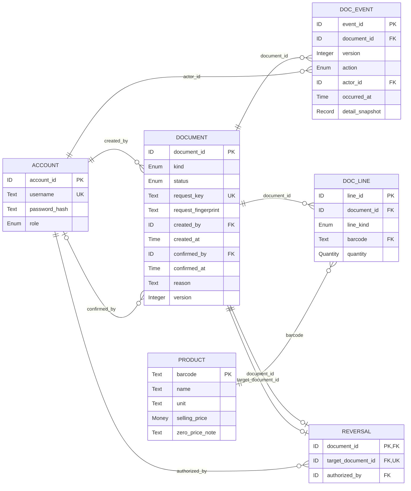
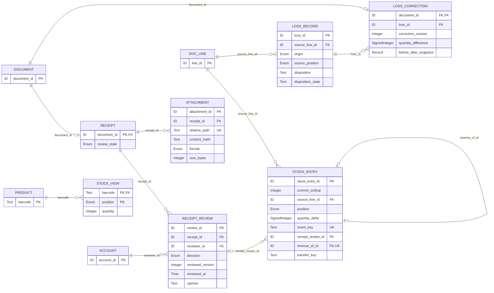
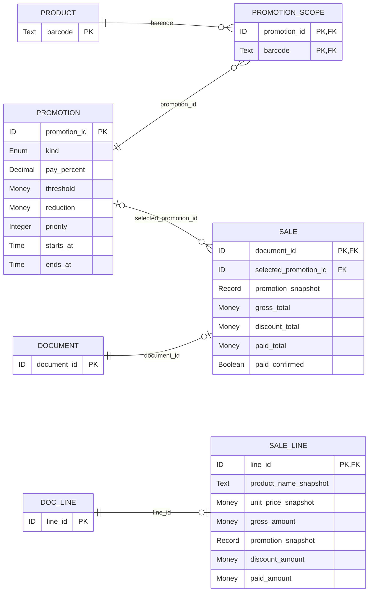
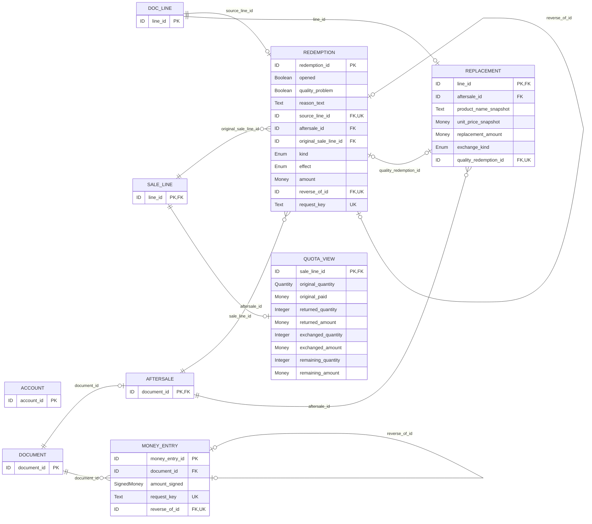

# Supermarket Management System Logical ERD

## 1 Document Status, Sources and Authority Boundaries

| Item | Content |
|---|---|
| Version/Date | 0.7, 2026-10-20, Asia/Shanghai; HEAD baseline + rebuild under this round's quota authorization |
| This file | [current ERD copy](./Project_ERD.md); repository-relative path `docs/Project_ERD.md` |
| Status | v0.7 is frozen as the requirements baseline (2026-10-20, effective with this commit); approval and pending status are governed solely by Spec §17, and D1/D2 have been explicitly approved by the user; no code / formal division of labour |
| Repository root | the top-level directory containing `README.md`, `.gitignore` and `docs/`; the local checkout is `Project1`, and no further `Project1` is nested inside the repository |
| Functional baseline | [current Spec copy](./Project_Spec.md) and [PRD](./Project_PRD.md), both v0.7; the jointly maintained mainline is the repository docs/ |
| Current artefacts | this working document, held as the English repository copy (the corresponding Chinese is kept outside the repository, Spec §17.6), and four Mermaid sub-views of the same model; D1/D2 are approved; technical designs such as root resolution / general attachment failure still await audit after delivery, and the specific division of labour is deferred; the final report is submitted in English; no SQL, business or test code yet |
| Existing files/backups | no target existed when the historical ERD was created; this round retains the existing ERD. Historical versions are recorded by Git, and this document does not define backup locations outside the repository; no backups are placed in docs |

### 1.1 Sources and Locations

| Source | Actually read and located in this round | Constraint on this design |
|---|---|---|
| C: `Projects1and2.pdf` | full-text extraction of 15 pages; the reader page numbers match the printed 1–15 on every page. p3 §1.1/1.2, p4–6 §1.3/1.4 and marking, p7–10 P2, p11–13 general/submission, p14–15 appendices | p4–5 require a Java CUI, OOP/SOLID, collections and File I/O, and standard Maven/Gradle; a relational database or an ERD deliverable is not required for P1; p3 requires use-case/class diagrams and at least two genuine design iterations, and an ERD cannot replace these diagrams |
| T: `Assignment1_Report_Template_CJLU2026.docx` | the OOXML body / all 13 tables plus footers and footnotes/endnotes (where present) were read; cited by section/field, with no claim that the printed pagination has been verified by rendering | §2.2 table ID/Requirement/Description-acceptance/Priority; §3.2 scope constraints, §3.3 Figure 2 initial class diagram, §3.4 review table, §3.5 Figure 3 final class diagram, §3.6 evolution table; §2.6/3.7 reflection must be written and signed by the student in person; appendix A/B log/contribution |
| S: `docs/Project_Spec.md` | read in full, 710 lines; focus on §4 FR-01–15, §5 permissions, §7.1/7.3/7.4, §8 BR-01–29, §9/9.1 ERD-C01–10, §10/11/13/14/15/16 | the confirmed scope/amount algorithms are the requirements basis; FR-14 and BR-23 cancellation records are not valid functions |
| P: `docs/Project_PRD.md` | read in full, 302 lines; focus on §3, PRD-03–09/12/13/15, §5.1/5.2, §6/7, §8/12 | §5.2 references S §9.1, and the after-sales formulas/snapshots are consistent with S; tracking only, with no separate business issue status table |
| U: user messages this round | §III–VIII and the nicknames of the two members | Chinese logical model only; P1 has no product date/batch; the P2 reserved wording differs from S/P, see §8 R1, and S/P are not modified |

The four sources were read successfully. The PDF text extractor reported several object-offset repairs, but continuous content was extracted from all 15 pages, so the key clauses are readable in this round; the extractor warnings were not treated as missing material, nor is any claim made that the visual layout of the PDF was checked. No external industry process is cited.

Path convention: the repository `docs/` is the single master copy of the documentation; Markdown links resolve relative to the directory containing this file, and the four diagram sources are uniformly `./erd/…`. The repository `docs/` is the single working mainline, historical versions are recorded by Git, and no copies outside the repository are maintained; the repository root is determined by `README.md`, `.gitignore` and `docs/`.

### 1.2 P1 Scope and Design Representation

P1 stock is measured only as product + mutually exclusive position "on-shelf/in-warehouse", with no production date, shelf life, expiry date, batch, near-expiry reminder or expiry-blocking entity/foreign key. The handling time, the promotion start/end and the 30-day after-sales period remain necessary business data. There is no supplier master data management, purchase order pre-approval, customer/membership, payment gateway or third unsellable stock bucket.

Entity names, field names, the common header/line, audit events and forward/reverse modelling are **design proposals of this ERD**, not newly added course-specified structures or approved Java class/table names; they are confirmed by review of the Chinese draft. Combined storage in JSON records/collections is permitted, and each entity is not required to correspond to a separate file or relational table. The common entities exist only to connect source documents, lines, ledger entries and redemptions, avoiding an arbitrary sourceType+sourceId without foreign key constraints.

### Path Conventions and Copy Identity

<!-- PATH-COPY-BEGIN -->
Path convention: this file resides in the repository `docs/`; Markdown links resolve relative to the directory containing this file, and the code-style `docs/evidence/...`, `docs/design/...`, `docs/decisions...` are all **repository-relative paths**. No further `Project1` is nested under the repository root; historical versions are recorded by Git, and no copies outside the repository are maintained.
<!-- PATH-COPY-END -->

Document history is recorded by Git, and this document does not define backup locations outside the repository. Runtime snapshot backups are based on `DATA_ROOT`. The current `docs/evidence/`, `docs/design/`, `docs/decisions/` and `docs/decisions.md` have not yet been created, are all planned paths, and cannot serve as completed evidence.

## 2 Types, Keys and Status Conventions

ID is an immutable Text; the concrete UUID/prefix generation method is left to later technical design and does not affect uniqueness. A stable sales line ID must define a deterministic ascending comparison, must not be reordered after the transaction is concluded, and must not be regenerated from new array indices when JSON is reloaded.

Money is RMB decimal with two places, HALF_UP; the four-place intermediate values and the per-line cent rounding follow S §7.3, without binary floating point; SignedMoney is a directional amount. Quantity is a business integer 1–9999; Integer is an integer; the accumulated stock balance is not forced under a hard "single 9999" cap. Text is text, Enum is a closed set, Boolean is boolean, Time is a recoverable business time that can be interpreted to Asia/Shanghai, and Record is a structured immutable snapshot (a logical type, not a database JSON column requirement).

Mandatory is defined relative to a complete record that can stand; an "at confirmation" field may be empty in a draft but must be complete before it takes effect. "Conditional" is governed by the constraint on that row. PK/UK/FK are logical integrity; the constituent fields of a composite PK must not each be mistakenly made single-column unique. In the diagrams `||` = exactly 1, `o` plus a vertical bar = 0 or 1, and `o{` = 0..N; each diagram draws only the main dependencies, and all foreign keys are registered in the sub-views and in §4 relationships. Conditionally mandatory is drawn as optional and tightened in the status rules.

The common DOCUMENT.status design vocabulary: DRAFT, PENDING_REVIEW, NEEDS_CORRECTION, APPROVED, CONFIRMED, VOIDED, CANCELLED; CANCELLED applies only to an after-sales draft that has successfully saved the IF-11 read trace and is not yet completed, and cancellation has no refund/stock/quota effect; receipts follow the review path, and other documents are not forced through review; an effective sale/after-sales etc. is CONFIRMED. A business VOIDED must at the same time have a reversing fact and must not merely change status. The receipt RECEIPT.review_state and the common header status are projections of the same fact, and two independent statuses are not allowed to combine freely. The internal enumerations are a design expression and do not expand the user approval process.

## 3 Entity Relationship Diagrams

The following four are **sub-views of the same logical model**, and an entity with the same name across views is the same entity; external entities list only the primary key to reduce clutter, and the complete fields are in the data dictionary. A relationship label is exactly the FK field name on the child side, and the name can be traced directly to §4. All cardinalities express the structural optionality of "record existence"; a confirmed document additionally requires at least one valid line. The shared-primary-key extension uses 0..1 and does not mean a sales order can lack sales semantics.

### Common Documents and Audit Trail

Diagram source: [01_common.mmd](./erd/01_common.mmd). A Chinese design source, not the English report.

### Receipt Review, Attachments and Inventory

Diagram source: [02_receipt_stock.mmd](./erd/02_receipt_stock.mmd). A Chinese design source, not the English report.

### Sales and Promotion Snapshots

Source: [03_sale_promotion.mmd](./erd/03_sale_promotion.mmd). Chinese design source diagram, not the English-version report.

### After-sales Dual Quotas and Reversing Money Entries

Source: [04_aftersale.mmd](./erd/04_aftersale.mmd). Chinese design source diagram, not the English-version report.

## 4 Relationship Register and Conditional Cardinality

Relationship ids R-xx are internal design indices of this ERD and **are not new requirement ids**. Each FK has exactly one relationship; mandatory conditions are validated in effect per §5. The relationship labels in the diagrams are consistent with the "child FK" column of this table.

| Relationship | Parent entity/key | Child entity.FK | Child record points to parent | Parent record may have child |
|---|---|---|---|---|
| R-01 | ACCOUNT.account_id | DOCUMENT.created_by | 1 (must exist) | 0..N |
| R-02 | ACCOUNT.account_id | DOCUMENT.confirmed_by | 0..1 (required when the condition holds) | 0..N |
| R-03 | DOCUMENT.document_id | DOC_EVENT.document_id | 1 (must exist) | 0..N |
| R-04 | ACCOUNT.account_id | DOC_EVENT.actor_id | 1 (must exist) | 0..N |
| R-05 | DOCUMENT.document_id | DOC_LINE.document_id | 1 (must exist) | 0..N |
| R-06 | PRODUCT.barcode | DOC_LINE.barcode | 1 (must exist) | 0..N |
| R-07 | DOCUMENT.document_id | RECEIPT.document_id | 1 (must exist) | 0..1 |
| R-08 | RECEIPT.document_id | RECEIPT_REVIEW.receipt_id | 1 (must exist) | 0..N |
| R-09 | ACCOUNT.account_id | RECEIPT_REVIEW.reviewer_id | 1 (must exist) | 0..N |
| R-10 | RECEIPT.document_id | ATTACHMENT.receipt_id | 1 (must exist) | 0..N |
| R-11 | PROMOTION.promotion_id | PROMOTION_SCOPE.promotion_id | 1 (must exist) | 0..N |
| R-12 | PRODUCT.barcode | PROMOTION_SCOPE.barcode | 1 (must exist) | 0..N |
| R-13 | DOCUMENT.document_id | SALE.document_id | 1 (must exist) | 0..1 |
| R-14 | PROMOTION.promotion_id | SALE.selected_promotion_id | 0..1 (required when the condition holds) | 0..N |
| R-15 | DOC_LINE.line_id | SALE_LINE.line_id | 1 (must exist) | 0..1 |
| R-16 | DOCUMENT.document_id | AFTERSALE.document_id | 1 (must exist) | 0..1 |
| R-18 | DOC_LINE.line_id | REDEMPTION.source_line_id | 1 (must exist) | 0..1 |
| R-19 | AFTERSALE.document_id | REDEMPTION.aftersale_id | 1 (must exist) | 0..N |
| R-20 | SALE_LINE.line_id | REDEMPTION.original_sale_line_id | 1 (must exist) | 0..N |
| R-21 | REDEMPTION.redemption_id | REDEMPTION.reverse_of_id | 0..1 (required when the condition holds) | 0..1 |
| R-22 | DOC_LINE.line_id | REPLACEMENT.line_id | 1 (must exist) | 0..1 |
| R-23 | AFTERSALE.document_id | REPLACEMENT.aftersale_id | 1 (must exist) | 0..N |
| R-24 | DOCUMENT.document_id | MONEY_ENTRY.document_id | 1 (must exist) | 0..N |
| R-25 | MONEY_ENTRY.money_entry_id | MONEY_ENTRY.reverse_of_id | 0..1 (required when the condition holds) | 0..1 |
| R-26 | DOC_LINE.line_id | STOCK_ENTRY.source_line_id | 1 (must exist) | 0..N |
| R-27 | RECEIPT_REVIEW.review_id | STOCK_ENTRY.receipt_review_id | 0..1 (required when the condition holds) | 0..N |
| R-28 | STOCK_ENTRY.stock_entry_id | STOCK_ENTRY.reverse_of_id | 0..1 (required when the condition holds) | 0..1 |
| R-29 | DOC_LINE.line_id | LOSS_RECORD.source_line_id | 1 (must exist) | 0..N |
| R-30 | DOCUMENT.document_id | REVERSAL.document_id | 1 (must exist) | 0..1 |
| R-31 | DOCUMENT.document_id | REVERSAL.target_document_id | 1 (must exist) | 0..1 |
| R-32 | ACCOUNT.account_id | REVERSAL.authorized_by | 1 (must exist) | 0..N |
| R-33 | DOCUMENT.document_id | LOSS_CORRECTION.document_id | 1 (must exist) | 0..1 |
| R-34 | LOSS_RECORD.loss_id | LOSS_CORRECTION.loss_id | 1 (must exist) | 0..N |
| R-35 | PRODUCT.barcode | STOCK_VIEW.barcode | 1 (must exist) | 0..N |
| R-36 | SALE_LINE.line_id | QUOTA_VIEW.sale_line_id | 1 (must exist) | 0..1 |
| R-37 | REDEMPTION.redemption_id | REPLACEMENT.quality_redemption_id | 0..1 (required for special pairing) | 0..1 |

R-17 was originally the store-manager qualification authorization relationship from ACCOUNT to AFTERSALE; CR07-10 has revoked it. The number is retained and not reused, and the relationship no longer appears in the diagrams.

Supplementary structural constraints:

- A DOCUMENT may have 0..N lines to accommodate drafts; submitting a receipt and confirming a sale/return/exchange/replenishment/loss registration must have at least one line, and a reversal must cover the entire effective impact of the original document. A DOC_LINE belongs to one DOCUMENT only.
- RECEIPT, SALE, AFTERSALE, REVERSAL, and LOSS_CORRECTION are conditional extensions of the common document; they are matched by kind and are mutually exclusive. The SALE_LINE/REPLACEMENT extensions of DOC_LINE follow the same rule. Replenishment/opening stock do not get separate shell entities; they use the common document/line and the corresponding ledger entries.
- The DOC_LINE.document_id to which a SALE_LINE belongs must point to a document that has a SALE extension; the mere existence of line_id must not be taken to mean the line is a sale line. The aftersale_id of a REPLACEMENT must equal the document_id of its source line, and the replacement must contain exchange detail.
- The original sale line association of a REDEMPTION is a directly verifiable reference; the product barcode must not be used in place of the original sale line. The source_line of a forward redemption must be the after-sales line belonging to its aftersale_id; the source_line of a release redemption belongs to a REVERSAL, its aftersale_id retains the original after-sales, and the reversing line is not wrongly required to still belong to the original document.
- Without Spec approval, it is not stipulated that "one after-sales document may reference only one sale document", nor is an exchange pairing algorithm invented for how many new items correspond to one old item; the original sale can be traced from each redemption line. If the interface requires stricter grouping, a separate design review should be raised, and the dual-quota model must not be changed.
- An ordinary replacement is associated through AFTERSALE; the special same-SKU same-quantity zero-quality-difference case authorized in this round is instead paired one-to-one explicitly via quality_redemption_id. The redemption category is recorded per line, and mixed returns and exchanges are allowed on the same document.
- The product of a STOCK_ENTRY is determined by DOC_LINE.barcode; no separately stored product FK that can drift is kept. The stock balance is aggregated by that barcode and position, and a single ledger entry must never belong to two positions at the same time.
- Composite PK: PROMOTION_SCOPE(promotion_id,barcode), STOCK_VIEW(barcode,position); composite UK: DOC_EVENT(document_id,version), LOSS_CORRECTION(loss_id,correction_version). Single-column UKs are marked in the diagrams and the field table. The reviewed inbound of a STOCK_ENTRY must also ensure that the same receipt line is posted as effective only once; different review_id values alone must not be relied on to prevent duplication.
- The multiple relationships of ACCOUNT represent document creation, confirmation, review, and authorization respectively; the person may be the same, and self-review is not prohibited by any foreign key or uniqueness constraint. Ordinary returns and exchanges have no store-manager qualification exception; return/exchange eligibility is judged by the opened/quality_problem of each REDEMPTION, and other reasons are only recorded in reason_text and do not constitute a qualification exception.

## 5 Data Dictionary

The field tables are the complete dictionary; the diagrams omit only the non-key fields of external entities in cross-view contexts. Derived views are not independent business facts. The FR/BR/ERD-C references in each entity description have been checked against the current S/P; English names such as ACCOUNT are not established Java class names in the Spec.

### ACCOUNT — Operator Account

Basis: FR-01/09; BR-04/16/21; R-AUTH.

| Field | Logical type | Required | Key/Reference | Meaning | Constraint/Consistency |
|---|---|---|---|---|---|
| account_id | ID | Yes | PK | Identifier of the specific operator account | A role string must not be used in place of an individual |
| username | Text | Yes | UK | Local login name | Locally unique |
| password_hash | Text | Yes | - | Password hash encoding | Not plaintext; the algorithm/salt are encapsulated within the encoding, and the specific algorithm is left to later security design |
| role | Enum | Yes | - | Role | Administrator/store manager/store clerk; permissions per Spec §5 |

### PRODUCT — Product

Basis: FR-02; BR-05/06; R-INPUT.

| Field | Logical type | Required | Key/Reference | Meaning | Constraint/Consistency |
|---|---|---|---|---|---|
| barcode | Text | Yes | PK | Product barcode | 8–14 digits, leading 0 preserved; unique |
| name | Text | Yes | - | Brand plus product name | A separate snapshot is stored at the time of sale |
| unit | Text | Yes | - | Unit of measure of the fixed package | No weighed or fractional quantities |
| selling_price | Money | Yes | - | Current selling price | 0–999999.99; a zero price must be explicitly marked |
| zero_price_note | Text | Conditional | - | Free-gift/zero-price note | Required when the selling price is 0 |

### DOCUMENT — Common Header of Business Documents

Basis: FR-03/05/07/08/09/12/13; BR-07/16/21/29.

| Field | Logical type | Required | Key/Reference | Meaning | Constraint/Consistency |
|---|---|---|---|---|---|
| document_id | ID | Yes | PK | Document identifier | Stable and globally unique |
| kind | Enum | Yes | - | Business type | Receipt/sale/return/exchange/mixed after-sales/replenishment/opening/loss registration/reversal/loss correction |
| status | Enum | Yes | - | Document status | See the §5 status conditions; it is not a stock location |
| request_key | Text | Yes | UK | Idempotency key of the entire business transaction | Unique; a request with the same key but different content is rejected |
| request_fingerprint | Text | At confirmation | - | Digest of the request content | Bound to the idempotency key to prevent different content under the same key |
| created_by | ID | Yes | FK:ACCOUNT.account_id | Creator | Exists and holds the operation permission |
| created_at | Time | Yes | - | Creation time | Interpretable time in Asia/Shanghai |
| confirmed_by | ID | At confirmation | FK:ACCOUNT.account_id | Confirming operator | Required after confirmation; after-sales does not require per-transaction store manager approval |
| confirmed_at | Time | At confirmation | - | Confirmation time | Consistent with the status and events |
| reason | Text | Conditional | - | Business reason | Must be recorded for after-sales/loss registration/supplementary correction/voiding/correction |
| version | Integer | Yes | - | Document revision version | Incremented; after confirmation only audit/reverse records are added |

### DOC_EVENT — Document Audit Event

Basis: FR-09/13; BR-16/21/25/29; ERD-C07/08.

| Field | Logical type | Required | Key/Reference | Meaning | Constraint/Consistency |
|---|---|---|---|---|---|
| event_id | ID | Yes | PK | Event identifier | Immutable |
| document_id | ID | Yes | FK:DOCUMENT.document_id | Owning document | Forms a UK with version |
| version | Integer | Yes | - | Event version | UK(document_id,version) |
| action | Enum | Yes | - | Action | Create/submit/supplementary correction/review/confirm/reverse/dispose/correct/READ_FOR_AFTERSALE/CANCEL_AFTERSALE (the last two are used only under the read and draft-cancellation conditions of CR07-11) |
| actor_id | ID | Yes | FK:ACCOUNT.account_id | Operator | Consistent with the permission for the action |
| occurred_at | Time | Yes | - | Occurrence time | Actual business time |
| detail_snapshot | Record | Yes | - | Snapshot of before/after changes and reasons | Records the necessary status/field differences; old events must not be overwritten |

### DOC_LINE — Common Product Line

Basis: FR-03/05/07/08/12/13; BR-06/07; ERD-C09.

| Field | Logical type | Required | Key/Reference | Meaning | Constraint/Consistency |
|---|---|---|---|---|---|
| line_id | ID | Yes | PK | Stable business line ID | Sale lines also use this ID; not reordered after confirmation |
| document_id | ID | Yes | FK:DOCUMENT.document_id | Owning document | A line belongs to exactly one document |
| line_kind | Enum | Yes | - | Line purpose | Receipt/sale/after-sales redemption/replacement item/replenishment/opening/loss registration/reverse/correction |
| barcode | Text | Yes | FK:PRODUCT.barcode | Product | Consistent with the product of all extension records/ledger entries |
| quantity | Quantity | Yes | - | Positive business quantity of this line | 1–9999; the ledger sign is recorded separately, and a negative quantity is not used to represent a customer purchase |

### RECEIPT — Extension for the Actual Receipt Document

Basis: FR-03; BR-03/19; Q04.

| Field | Logical type | Required | Key/Reference | Meaning | Constraint/Consistency |
|---|---|---|---|---|---|
| document_id | ID | Yes | PK,FK:DOCUMENT.document_id | Receipt document header | kind must be receipt; the lines are DOC_LINE receipt lines |
| review_state | Enum | Yes | - | Receipt review status | Pending review/review approved/returned for supplementary correction; consistent with the common status |

### RECEIPT_REVIEW — Receipt Review Record

Basis: FR-03/15; BR-03/07/19.

| Field | Logical type | Required | Key/Reference | Meaning | Constraint/Consistency |
|---|---|---|---|---|---|
| review_id | ID | Yes | PK | Review event | Each decision is retained separately |
| receipt_id | ID | Yes | FK:RECEIPT.document_id | Receipt document under review | The same document may be corrected/re-reviewed, with at most one effective approval posted |
| reviewer_id | ID | Yes | FK:ACCOUNT.account_id | Reviewer | Store manager or administrator authorised to review; may be the original creator |
| decision | Enum | Yes | - | Review result | Approved/returned for supplementary correction |
| reviewed_version | Integer | Yes | - | Version of the document under review | A stale version must not be posted |
| reviewed_at | Time | Yes | - | Review time | Stock ledger entries generated after approval must take effect in the same transaction |
| opinion | Text | Yes | - | Review basis/opinion | A missing image does not automatically block the review |

### ATTACHMENT — Purchase Invoice Image

Basis: FR-15; BR-19/27; R-INPUT.

| Field | Logical type | Required | Key/Reference | Meaning | Constraint/Consistency |
|---|---|---|---|---|---|
| attachment_id | ID | Yes | PK | Attachment identifier | Unique |
| receipt_id | ID | Yes | FK:RECEIPT.document_id | Associated receipt document | 0–3 per document; the review can proceed without an image |
| relative_path | Text | Yes | UK | Local copy path | Named by an independent ID, stored relative to DATA_ROOT as `attachments/<ID-named file>`, with a uniform `/`; does not contain the source absolute path; security rules in Spec §10.1, the root location is already fixed at the repository root data/, while root resolution/sub-layout/general failure flow remain technical design |
| content_hash | Text | Yes | - | Hash of the copy content | Verified on recovery; not used as a hard constraint for cross-document deduplication |
| format | Enum | Yes | - | Image format | JPG/PNG |
| size_bytes | Integer | Yes | - | Size | ≤5,000,000 bytes per image, per Spec §17 SYNC-04; the original R4 byte criterion is closed |

### PROMOTION — Promotion Configuration

Basis: FR-06; BR-09/11/28; R-PROMO/R-INPUT.

| Field | Logical type | Required | Key/Reference | Meaning | Constraint/Consistency |
|---|---|---|---|---|---|
| promotion_id | ID | Yes | PK | Campaign ID | Equal prices are ultimately compared by stable ID |
| kind | Enum | Yes | - | Discount type | Percentage discount/threshold reduction |
| pay_percent | Decimal | For percentage discount | - | Payment ratio percentage | 1–99%; 90 means a 10% discount |
| threshold | Money | For threshold reduction | - | Threshold | >0 |
| reduction | Money | For threshold reduction | - | Threshold-reduction amount | >0 and ≤threshold |
| priority | Integer | No | - | Explicit priority | Present beats absent, high beats low; on a tie or when both are absent, by smaller ID |
| starts_at | Time | Yes | - | Campaign start | 00:00:00 on the start date, boundary inclusive |
| ends_at | Time | Yes | - | Campaign end | 23:59:59 on the end date, boundary inclusive; not the product expiry date |

### PROMOTION_SCOPE — Campaign Applicable-Product Association

Basis: FR-06; BR-28; ERD-C02.

| Field | Logical type | Required | Key/Reference | Meaning | Constraint/Consistency |
|---|---|---|---|---|---|
| promotion_id | ID | Yes | PK,FK:PROMOTION.promotion_id | Campaign | Forms a composite PK with barcode |
| barcode | Text | Yes | PK,FK:PRODUCT.barcode | Applicable product | Expresses only an explicit applicable set; does not extend to category/member discounts |

### SALE — Extension for the Completed Sale Document

Basis: FR-05/06; BR-07/10/11; ERD-C01/02.

| Field | Logical type | Required | Key/Reference | Meaning | Constraint/Consistency |
|---|---|---|---|---|---|
| document_id | ID | Yes | PK,FK:DOCUMENT.document_id | Sale document | kind is sale |
| selected_promotion_id | ID | No | FK:PROMOTION.promotion_id | Selected single campaign | May have no campaign; selecting several campaigns for one document at the same time is not allowed |
| promotion_snapshot | Record | Yes | - | Snapshot of campaign parameters/applicable set/priority | NONE is also explicitly recorded when there is no campaign; later changes do not affect the original document |
| gross_total | Money | At confirmation | - | Pre-discount total | Equal to the sum of the line gross_amount |
| discount_total | Money | At confirmation | - | Order discount | Equal to the sum of the line discount_amount |
| paid_total | Money | At confirmation | - | Order actual amount received/payable | Equal to the sum of the line paid_amount and to the confirmed payment |
| paid_confirmed | Boolean | Yes | - | Payment completion confirmation | Must be true for a confirmed sale; does not represent integration with a payment gateway |

### SALE_LINE — Immutable Sold-Line Snapshot

Basis: FR-05/06/07; BR-10/13/28; ERD-C01/02.

| Field | Logical type | Required | Key/Reference | Meaning | Constraint/Consistency |
|---|---|---|---|---|---|
| line_id | ID | Yes | PK,FK:DOC_LINE.line_id | Sale line ID | The document owning this DOC_LINE must have a SALE extension |
| product_name_snapshot | Text | Yes | - | Name of the sold product | Must not be overwritten with the current product name |
| unit_price_snapshot | Money | Yes | - | Sold unit price | The quantity comes from DOC_LINE.quantity and cannot be changed after confirmation |
| gross_amount | Money | Yes | - | Pre-discount line amount | Unit price × quantity, rounded to cents per the confirmed rules |
| promotion_snapshot | Record | Yes | - | Campaign and applicability of this line | States NONE/not applicable/campaign ID and parameters, and the basis of the applicable weight |
| discount_amount | Money | Yes | - | Discount allocation of this line | ≥0 and ≤gross_amount; largest remainder in integer cents; equal remainders by ascending stable sale line ID |
| paid_amount | Money | Yes | - | Original actual paid P of this line | gross_amount−discount_amount; the sole amount cap for after-sales |

### AFTERSALE — Return/Exchange Business Extension

Basis: FR-07/08; BR-21/22/26; ERD-C03/06.

| Field | Logical type | Required | Key/Reference | Meaning | Constraint/Consistency |
|---|---|---|---|---|---|
| document_id | ID | Yes | PK,FK:DOCUMENT.document_id | After-sales document | kind is return, exchange or mixed after-sales; eligibility is determined by the redemption lines |

### REDEMPTION — After-Sales Original-Line Quota Redemption and Reverse Record

Basis: FR-07/08/09; BR-12/13/15/29; ERD-C03–08.

| Field | Logical type | Required | Key/Reference | Meaning | Constraint/Consistency |
|---|---|---|---|---|---|
| redemption_id | ID | Yes | PK | Redemption event identifier | Immutable |
| opened | Boolean | Yes | - | Whether opened | Determines eligibility together with quality_problem |
| quality_problem | Boolean | Yes | - | Whether due to a product quality reason | true means quality; false means another/non-quality reason and does not exempt the stock validation |
| reason_text | Text | Conditional | - | Description of another reason | Required and must not be blank when quality_problem=false; serves only as a record, and does not change the 30-day, opened/quality, or quantity/amount/stock validations |
| source_line_id | ID | Yes | UK,FK:DOC_LINE.line_id | Source after-sales or reversal business line | The UK ensures that the same business line does not take effect twice |
| aftersale_id | ID | Yes | FK:AFTERSALE.document_id | Original after-sales document | Reverse events also retain the original after-sales association |
| original_sale_line_id | ID | Yes | FK:SALE_LINE.line_id | Original sold line | Each redemption is associated with only one original line |
| kind | Enum | Yes | - | Redemption category | Return refund/exchange deduction of the original product |
| effect | Enum | Yes | - | Consume or release | CONSUME/RELEASE; release comes only from an authorised whole-document reversal |
| amount | Money | Yes | - | Original-product quota amount | ≥0; not the new-product price or the customer's additional payment |
| reverse_of_id | ID | At release | UK,FK:REDEMPTION.redemption_id | Reverse event linked to the original redemption | 0..1; each original redemption is released at most once; self-reference and release-upon-release are forbidden |
| request_key | Text | Yes | UK | Redemption request key | Different content under the same key is rejected; bound to the whole-document atomic key |

### REPLACEMENT — Goods issued to the customer for an exchange

Basis: FR-08; BR-15/20; ERD-C06.

| Field | Logical type | Required | Key/Reference | Meaning | Constraint/Consistency |
|---|---|---|---|---|---|
| line_id | ID | Yes | PK,FK:DOC_LINE.line_id | Replacement product business line | line_kind must be replacement item |
| aftersale_id | ID | Yes | FK:AFTERSALE.document_id | Exchange or mixed after-sales document | Same document as the owning DOC_LINE; exchange or mixed after-sales allowed, pairing by detail line; erratum basis Spec §17 SYNC-05 |
| product_name_snapshot | Text | Yes | - | Replacement item name | Traceable |
| unit_price_snapshot | Money | Yes | - | Snapshot of the new item's current selling price | Not used to overwrite the original line's P |
| replacement_amount | Money | Yes | - | Amount of this replacement line | Calculated from the new item's snapshot and quantity; deducted from on-shelf only |
| exchange_kind | Enum | On exchange | - | Exchange pricing case | General exchange / same model, same quantity quality exchange with zero top-up; verified against the original line's facts |
| quality_redemption_id | ID | Required for special-quality same-model zero-difference | FK:REDEMPTION.redemption_id,UK | Explicit pairing | Same-document exchange CONSUME, quality issue, identical original/replacement barcode and quantity, difference 0; empty for ordinary replacement |

### MONEY_ENTRY — Payment/refund and top-up/refund-difference records

Basis: FR-05/07/08/09; BR-07/15/16; ERD-C06–08.

| Field | Logical type | Required | Key/Reference | Meaning | Constraint/Consistency |
|---|---|---|---|---|---|
| money_entry_id | ID | Yes | PK | Payment record identifier | Immutable |
| document_id | ID | Yes | FK:DOCUMENT.document_id | Source document | Sale/return/exchange/reversal |
| amount_signed | SignedMoney | Yes | - | Positive for supermarket receipt, negative for refund | 0 may be used for zero top-up confirmation; not to be confused with the original product redemption amount |
| request_key | Text | Yes | UK | Payment idempotency key | The same whole order cannot be charged or refunded twice in one occurrence |
| reverse_of_id | ID | On reversal | UK,FK:MONEY_ENTRY.money_entry_id | Original payment record | One-to-zero or one reversal; opposite sign and equal absolute amount |

### STOCK_ENTRY — Stock ledger

Basis: FR-03/04/05/08/09/12/13; BR-03/07/08/20/25; ERD-C06–09.

| Field | Logical type | Required | Key/Reference | Meaning | Constraint/Consistency |
|---|---|---|---|---|---|
| stock_entry_id | ID | Yes | PK | Stock event identifier | Immutable |
| commit_ordinal | Integer | Yes | - | Atomic commit ordinal | Positive integer ≤ the snapshot root's last_commit_ordinal; stock ledger entries of the same commit share the number and different commits increase; not a UK; basis for D1, Spec §10.2/17 CR07-07 |
| source_line_id | ID | Yes | FK:DOC_LINE.line_id | Business source line | Traced from here to the document and the operator/time |
| position | Enum | Yes | - | Single stock position | On-shelf or in-warehouse, exactly one of the two |
| quantity_delta | SignedInteger | Yes | - | Signed change amount | Non-zero; the product is determined by the source line |
| event_key | Text | Yes | UK | Posting event key | The same review/sale/replenishment/exchange/loss registration occurrence is not recorded twice |
| receipt_review_id | ID | On reviewed stock-in | FK:RECEIPT_REVIEW.review_id | Source of the passed review | Required when receiving into the warehouse, empty for other changes |
| reverse_of_id | ID | On reversal | UK,FK:STOCK_ENTRY.stock_entry_id | Reversed ledger entry | Same product position and opposite quantity, at most once |
| transfer_key | Text | On replenishment | - | Same-occurrence transfer correlation | Corresponds to one in-warehouse negative / one on-shelf positive, summing to 0 |

### LOSS_RECORD — Loss or pending-disposal record

Basis: FR-07/08/13; BR-14/21/25; ERD-C06/08.

| Field | Logical type | Required | Key/Reference | Meaning | Constraint/Consistency |
|---|---|---|---|---|---|
| loss_id | ID | Yes | PK | Loss record | Not a stock bucket |
| source_line_id | ID | Yes | FK:DOC_LINE.line_id | Loss registration or customer-returned source line | Product/quantity determined by the source line |
| origin | Enum | Yes | - | Loss origin | In-store existing stock/customer-returned |
| source_position | Enum | On in-store existing stock | - | Original stock position | On-shelf/in-warehouse; must be empty for customer-returned |
| disposition | Text | Yes | - | Actual destination/temporary handling | Must not add a third stock balance |
| disposition_state | Text | Yes | - | Actual processing progress | The name is a design expression and adds no approval flow |

### REVERSAL — Authorized whole-document reversal

Basis: FR-09; BR-16/29; R-VOID; ERD-C08.

| Field | Logical type | Required | Key/Reference | Meaning | Constraint/Consistency |
|---|---|---|---|---|---|
| document_id | ID | Yes | PK,FK:DOCUMENT.document_id | Reversal document | kind is reversal; only whole-document reversal is performed each time |
| target_document_id | ID | Yes | UK,FK:DOCUMENT.document_id | Original document being voided | No physical deletion; prohibited while unresolved downstream dependencies exist |
| authorized_by | ID | Yes | FK:ACCOUNT.account_id | Authorizer | Store manager/administrator; the reason comes from this document's DOCUMENT.reason |

### LOSS_CORRECTION — Loss registration correction record

Basis: FR-13; BR-25; R-VOID; ERD-C08.

| Field | Logical type | Required | Key/Reference | Meaning | Constraint/Consistency |
|---|---|---|---|---|---|
| document_id | ID | Yes | PK,FK:DOCUMENT.document_id | Correction document | kind is loss registration correction, reason/operator/time are in the common header |
| loss_id | ID | Yes | FK:LOSS_RECORD.loss_id | Original loss being corrected | The original record is retained |
| correction_version | Integer | Yes | - | Correction version | UK(loss_id,correction_version) |
| quantity_difference | SignedInteger | Yes | - | Quantity difference relative to the previous version | May be positive/negative/0; does not make stock negative |
| before_after_snapshot | Record | Yes | - | Differences before/after correction and in disposal | Must not merely overwrite the original record; the stock impact must correspond to ledger entries |

### STOCK_VIEW — Stock balance view (derived)

Basis: FR-04; BR-08/20; ERD-C09/10.

| Field | Logical type | Required | Key/Reference | Meaning | Constraint/Consistency |
|---|---|---|---|---|---|
| barcode | Text | Yes | PK,FK:PRODUCT.barcode | Product | Forms a composite PK with position |
| position | Enum | Yes | PK | Position | On-shelf/in-warehouse; a balance row does not express product status |
| quantity | Integer | Yes | - | Balance at the corresponding position | Σ of the valid signed ledger entries for this product at this position; ≥0; a missing row counts as 0, and pending-review quantity is not added |

### QUOTA_VIEW — After-sales quota view of the original sale line (derived)

Basis: FR-07/08; BR-12/13/15/29; ERD-C04/05.

| Field | Logical type | Required | Key/Reference | Meaning | Constraint/Consistency |
|---|---|---|---|---|---|
| sale_line_id | ID | Yes | PK,FK:SALE_LINE.line_id | Original sale line | At most one cache, on-the-fly calculation permitted |
| original_quantity | Quantity | Yes | - | Original purchased Q | From DOC_LINE.quantity |
| original_paid | Money | Yes | - | Original actual paid P | From SALE_LINE.paid_amount |
| returned_quantity | Integer | Yes | - | Returned Qr | Net amount including lawful releases |
| returned_amount | Money | Yes | - | Refunded quota Mr | Not an additional independent budget |
| exchanged_quantity | Integer | Yes | - | Exchanged Qx | Net amount including lawful releases |
| exchanged_amount | Money | Yes | - | Mx already applied as original-product offset for exchanges | Zero-top-up exchanges also consume it |
| remaining_quantity | Integer | Yes | - | Q−Qr−Qx | ≥0 |
| remaining_amount | Money | Yes | - | P−Mr−Mx | ≥0; settling the quantity uses all of this balance |

## 6 Cross-entity Integrity and P1 File Persistence

PK/FK and the diagram itself cannot enforce cross-row aggregation, approval, atomicity or permissions. The following are the model's validation contracts, to be guaranteed later by the approved business/file persistence implementation; these contracts were not implemented or tested in this round.

### 6.1 Receipt, Review and Attachments

Pending-review/correction DOC_LINE quantities on a RECEIPT are used only for pending-review display, must not be added to STOCK_VIEW, and are not a third stock bucket. A review event retains the reviewed version; the store manager may review a document the manager created, and an administrator may technically review but does not carry day-to-day responsibility. Only the first effective pass can produce in-warehouse +q for each receipt line, STOCK_ENTRY.receipt_review_id points to that pass event, and source_line_id together with event_key ensures that repeated submission/repeated passing does not add a second stock-in. Returning for supplementation/correction produces no ledger entries, and after modification the current version must be reviewed again.

After a pass, posted facts must not be changed by editing the old detail lines; they must be handled per S R-VOID and the established correction/reversal constraints, and "correction" must not be treated as a supplier return. Attachments: 0–3, JPG/PNG and size per R-INPUT; with no image the store manager still judges pass or correction as usual, and no automatic invoice recognition/networked approval flow is built.

### 6.2 Quantity Inventory and Traceability

Balance(product,position) = the sum of quantity_delta over all effective original ledger entries and reversal ledger entries; an original ledger entry must not be additionally excluded from the aggregate because its original document is VOIDED, otherwise adding the reversal ledger entry would double-reverse. A not-yet-effective document writes no effective ledger entries; a failed whole document has no partial events. A cache may only be rebuilt from facts, and the balance must not be changed separately to bypass ledger entries.

| Document/action | Quantity impact that must be produced | Source/constraint |
|---|---|---|
| Opening balance | Store manager/administrator may register, store clerk may not; specified product/position +q, with an opening source document/line | BR-08/20; balances are not edited directly without a source |
| Receipt review passed | In-warehouse +q | Pending review/correction both 0; must not pass twice and stock in twice |
| Replenishment | Under the same transfer_key in-warehouse −q, on-shelf +q, same product same document line, summing to 0 | Must not be counted twice at both positions, rejected when the source in-warehouse quantity is insufficient |
| Sale confirmation | On-shelf −q, all lines of the whole document check stock together, confirming payment received | Must not be offset from in-warehouse, no held orders/payment gateway |
| Exchange replacement item | Every REPLACEMENT source line on-shelf −q | Returned old item 0; the replacement item must not escape deduction because the exchange top-up is 0 |
| Customer return/exchanged-back item | Both positions 0; LOSS_RECORD.origin is customer-returned | source_position is empty, existing stock is not deducted again |
| In-store loss registration | Source position −q, with the actual disposal recorded separately | Later disposal updates/appends an audit entry, without deducting stock again |
| Whole-document reversal | Every original STOCK_ENTRY has a reversal row with the same product/position and opposite quantity, reverse_of_id must not repeat | Reason/authorization are tracked by REVERSAL and the common header, changing only the status is not allowed |
| Loss registration correction | LOSS_CORRECTION records version/difference/before-after; if it affects quantity, a corresponding difference ledger entry | Corrected by an administrator, without overwriting the original record and without making stock negative |

The corresponding position balance must be ≥0 after any stock-out; negative-stock correction is not allowed, and an anomaly is checked by displaying that product's stock-in records per source document/line. Whole-document reversal is prohibited while the original sale's after-sales association is unresolved or the D1 stock dependency is unresolved; this model provides the source chain and **does not claim that aggregating the two positions can prove the exact source of each consumption**. Dependencies are judged only per Spec §7.5 D1 for each product/position over effective negative ledger entries with a greater commit_ordinal; the same ordinal is not a successor to itself, and a complete reversal of an original/reversal pair is excluded as a group; no batch tracking is introduced.

### 6.3 Sales Snapshots and Promotion Allocation

Keep the existing pre-discount line-amount rules: unit price × quantity retains a 4-decimal intermediate value; line amounts use 2-decimal HALF_UP. Order totals and candidate comparisons use integer fen. Calculate each single promotion candidate separately, select the lowest order payable amount, and resolve equal payables using the existing explicit priority and promotion ID rules. Promotions do not stack.

After selecting an order discount of D fen, allocate it only to eligible sale lines. Let w be a line's pre-discount subtotal in integer fen and W the sum of eligible weights. If D>0, W must be >0. First allocate floor(D×w/W) to each line; distribute remaining fen by descending exact integer remainder, breaking equal remainders by immutable SALE_LINE.line_id ascending. Ineligible lines receive 0 discount. No generic multi-round capping/recalculation, renormalization or fallback equal-split algorithm is used.

Before confirmation, verify for each line 0 ≤ discount ≤ its applicable pre-discount amount, actual paid = original amount − discount ≥ 0, Σ line discounts = D, Σ line actual paid = whole-document payable; if any invariant fails, reject the entire calculation and generate no partial sale record. Persist the product name, unit price, promotion and applicability basis, pre-discount amount, allocated discount, actual paid and the stable sale line ID. The above rules replace the old rule of carrying the residual difference on the last promotion line; the after-sales HALF_UP rule is unchanged. Authorization and history: see Spec §17 CR07-02.

Corresponds to Spec §7.3, BR-28, ERD-C01/02; SALE_LINE.line_id is an existing immutable PK/FK, and no new ID system is added. AC-41: with three applicable lines of 10 each and a discount of 10, the discounts are 3.34/3.33/3.33 and the actual paid is 6.66/6.67/6.67.

### 6.4 Shared Return/Exchange Quantity and Amount Quotas

For each original SALE_LINE, Q is its DOC_LINE.quantity and P is its paid_amount. A forward REDEMPTION.effect=CONSUME counts toward returned/exchanged quantity, and a legitimate RELEASE only subtracts in reverse the quantity and amount of the original event it references. RELEASE must not be executed independently and repeatedly as a new refund or new stock-inbound event.

Qremain=Q−Qr−Qx; Premain=P−Mr−Mx; both must be ≥0 at the same time. While unsettled, occupy min(HALF_UP(P×q/Q,2),Premain); when this submission settles the remaining quantity, use all of Premain. The processing order within one document and the split-settlement rules are given below; **do not retroactively reorder effective history, and do not interpret "exchange first" as arbitrarily crowding out an old refund**. Amounts follow the original sale line; do not allocate a separate refund budget across lines. When the original document is zero-priced, P=0; a legitimate return/exchange still redeems quantity, the amount may be 0, and idempotency/quantity validation is not skipped because the amount is 0.

The original-product deduction is REDEMPTION.amount; the new-product amount is REPLACEMENT.replacement_amount; the customer's settle-up difference is MONEY_ENTRY.amount_signed; the three must not be conflated into one field. For an ordinary exchange, new-product amount − original-product deduction of this submission = settle-up difference; the special quality pairing is described later in this section and still consumes the original quantity/amount. Return cash is negative in direction, while the original line's redemption amount remains a non-negative quota.

| Confirmed scenario | Exchanged Qx/Mx | Returned Qr/Mr | Remaining quantity/amount |
|---|---|---|---|
| Original Q=3, P=10.00, no after-sales | 0/0 | 0/0 | 3/10.00 |
| Exchange 1 item first (AC-56) | 1/3.33 | 0/0 | 2/6.67 |
| Then return the remaining 2 items (AC-56) | 1/3.33 | 2/6.67 | 0/0; total redeemed 3 items/10.00 |
| Same-model zero-difference quality exchange of 1 item, original Q=1, P=8 (AC-58) | 1/8.00 | 0/0 | 0/0; the 8 must not be refunded again afterwards |

Each confirmation checks both balances at the same commit boundary and writes the original redemption, the money entries, the loss destination and the replacement ledger entries. QUOTA_VIEW is a recomputable projection; the after-sales module must not each maintain its own separate "refundable amount".

Independent business rule CR07-04: within one after-sales submission, calculate all exchange redemptions before refunds regardless of UI entry order; do not recalculate historical confirmed consumption. Store opened, quality_problem and reason_text per REDEMPTION rather than the header. A document may mix eligibility facts and exchange kinds. The header no longer carries a manager eligibility exception/exception reason. Other reasons require reason_text, which does not replace each line's eligibility facts.

Calculate per original sale line using this section's P×q/Q, HALF_UP and remaining-quota rules. Within the current submission, process split lines of the same kind by stable redemption_id ascending; do not use listed, procurement or current price. Only if the current submission exactly settles all quantity then remaining on that original line does the last settling detail in this order take the remaining fen. Non-final details use min(HALF_UP(P×q/Q,2),remaining amount at that point). Future after-sales operations must not rewrite amounts already confirmed.

exchange_kind belongs to REPLACEMENT. A special same-product, same-quantity quality exchange with zero difference explicitly references its same-document exchange CONSUME redemption through REPLACEMENT.quality_redemption_id. This unique reference requires quality_problem=true, identical original/replacement barcodes and quantities, and a 0 cash difference. Ordinary replacement lines leave that reference empty. Replacements deduct only on-shelf stock; returned goods do not re-enter inventory. Keep redeemed original paid credit, replacement amount and cash difference distinct. Special pairing must not waive the difference for other ordinary exchanges. See ERD §5 and CR07-01/03/04.

Field definitions are in §5 and the pairing relationship R-37 is in §4; this section is the sole normative statement in this ERD of after-sales order, split settlement and quality pairing.

After-sales read association follows Spec §17 SYNC-02 and CR07-11: IF-11 traceability returns the minimal original sales data needed to process after-sales only after IF-05 has saved it reliably; if saving fails, nothing is returned for the time being. When an after-sales draft whose read trace was saved successfully is cancelled, it enters CANCELLED, retaining the association of the operator who actually read — the original sales document — the target after-sales document, without physical deletion; drafts without a read trace are still deleted under the original rules. Cancellation produces no refund, stock or quota change, and completed after-sales is not subject to this cancellation procedure. Reuse DOCUMENT/AFTERSALE/DOC_EVENT and add no new entity. DOC_EVENT.document_id points to the target after-sales document, actor_id is the person who actually read, occurred_at is the read time, action=READ_FOR_AFTERSALE, and detail_snapshot stores the original sales ID and the returned line IDs. Cancellation is saved in the same commit as the CANCEL_AFTERSALE event and DOCUMENT.status=CANCELLED, retaining the read event and a closed reference; completed after-sales still executes the existing whole-document reversal rules. Field/transaction implementation is centrally audited by B after delivery; AC-87–90 are all not executed.

### 6.5 Idempotency, Reversal Audit Trail and File Recovery

DOCUMENT.request_key protects the whole document, while the unique event keys of redemptions/money/stock protect the specific effective records; the same key with the same content returns the existing result, and the same key with different content is rejected. The fingerprint is only a design device, not a newly added user authentication feature. Forward redemptions have a unique source_line_id; review inbound is additionally restricted by the original receipt line/first effective approval, and a "new review ID" must not simply be used as a reason for re-inbound.

Drafts are normally deletable per S BR-16; CR07-11 provides a local exception: an unfinished after-sales draft whose IF-11 read trace was saved successfully enters CANCELLED when cancelled, retaining the operator/original sales/target after-sales document and the events, without physical deletion and without refund/stock/quota impact. Drafts without a read trace are still deleted under the original rules; confirmed documents, or lines referenced by effective facts, must not be deleted, and cleanup must not leave dangling references.

A reversal first confirms authorization, the original sales after-sales association, and that the D1 same-product/location/later-commit valid negative-ledger check passes, with REVERSAL.target_document_id unique; it then generates the reverse DOC_LINE, STOCK_ENTRY, MONEY_ENTRY and REDEMPTION RELEASE, each reference pointing to the original record. A confirmed document must not be physically deleted, nor merely set to VOIDED, nor have only the quantity released without the amount. Reverse events must be one-for-one opposite in quantity/amount to the target original records, and the unique reverse_of_id prevents a second release; self-reference or circular references are prohibited; forward and reverse roles must be consistent. The business process for further operations on a reversal document is not specified in the baseline; this ERD neither approves nor prohibits it on its own and models only the confirmed original document and the reversal audit.

The P1 implementation required by S FR-10/TC-05/08 remains a UTF-8 JSON single snapshot/schemaVersion/Jackson, temporary write + atomic replacement + previous-version backup; the D2 single-writer and root last_commit_ordinal/ledger entry commit_ordinal rules are in §6.7; this diagram adds no database transaction. The whole document is first validated on a working copy, and success feedback/visible in-memory state is updated only when the new snapshot takes effect completely; if writing fails, the old state is retained. Stock ledger entries, redemptions, money entries and documents must belong to the same committed snapshot and must not be saved separately to form half an after-sales transaction. Relative attachment paths/hashes should be verifiable in the snapshot association; a residual copy from a failed import must not form an approved business record.

Startup/recovery validates PK/UK, FK existence and type, document status, snapshot equations, confirmed sales receipts, non-negative locations, the two quota caps, reverse record amount/quantity/direction, review posting idempotency, and attachment paths/hashes; corruption blocks writing and prompts recovery, and does not automatically overwrite with an empty store. The file root's schemaVersion and last_commit_ordinal are storage metadata and are not forcibly turned into business entities in this diagram; the concrete JSON layout and version compatibility are subsequent technical design; DATA_ROOT positioning and attachment failure semantics only reference Spec §10.1 PATH-D01/02, are not decided unilaterally by this ERD, and do not constitute an ERD relationship review blocker.

### 6.6 Runtime Path Governance Reference

DATA_ROOT is fixed as the repository root data/, attachments are named by independent ID and are ≤5,000,000 bytes; content is judged manually, and the system only performs file saving and technical checks, with no OCR/automatic ticket validation/content review. The technical design remaining before implementation is root resolution/sub-layout, extensions/duplicate names and general failure handling, based on Spec §17 SYNC-03/04. These are existing items pending design; they add no FR, BR or business acceptance requirement; the question and its status reference only Spec §10.1/§17.

The attachment `relative_path` stores `attachments/<file name>` only relative to DATA_ROOT and uses `/`; it is not relative to the repository, the working directory, the JAR or this Markdown. Path traversal/absolute references/real paths outside the root must be rejected; Chinese characters and spaces are handled as-is, and silently overwriting a verified copy is prohibited. The DATA_ROOT location is fixed as the repository root data/; general attachment failure handling/root resolution/sub-layout remain Spec §17 technical design; missing/reference/hash anomalies in a D2 full recovery must block writing, uniformly referencing [Spec §10.1](./Project_Spec.md#101-runtime-path-contract-and-pending-design) PATH-D01/02; the business approval policy for generated file names, duplicate names or missing attachments cannot be inferred from the diagram's PK/UK. Document history is recorded by Git, whereas the previous-version backup of a runtime snapshot is a pending runtime layout under DATA_ROOT; the two are kept separate.

### 6.7 D2 Commit Order and Recovery in One Snapshot

The normative basis is only Spec §10.2 and §17 CR07-07; last_commit_ordinal is a required non-negative Integer storage metadata field of the snapshot root, is not drawn as a business entity, and generates no separate counter file. STOCK_ENTRY.commit_ordinal is a required positive integer and a non-unique key; all ledger entries of one successful commit have the same number, different commits increment, and no commit_index or COMMIT entity is added. D1 determines what follows by strict greater-than; a commit with no ledger entries also advances the root last.

At startup, acquire a local lock file/operating-system file write lock under DATA_ROOT; a process that does not obtain the lock may only read or is refused writes. Each commit reads last inside the single-writer lock and uses last+1 as the in-memory candidate; counter/business/stock/redemption/money data are written into the same new JSON snapshot, and only after the temporary file + atomic replacement succeeds does it become uniformly visible and the result is published. If any step of validation/serialization/temporary write/replacement fails, the old snapshot remains complete and startable, last is unchanged, the candidate does not take effect, no partial records exist, and the failed candidate may be reused. A crash before responding after a successful replacement is governed by the new snapshot already on disk, and retries of an idempotent request must not post twice; a temporary file must not be loaded as a commit result.

Startup/recovery validates last≥max(commit_ordinal) (max=0 when there are no ledger entries) and the type/positive-value constraints; if last is less than max, or an association/attachment is missing or a hash is wrong, it blocks writing and prompts recovery/manual verification. last greater than max is legal; the next commit starts from last+1. A full recovery restores the same backup snapshot and its associated attachments and must not splice counters/ledger entries/attachments from different sources; then all the original integrity checks are performed. Timestamps/IDs/document version/file order cannot substitute for commit_ordinal. AC-85 lists eight categories of core checks plus the extensions for commits with no stock and abnormal recovery, all not executed.

## 7 Requirements Traceability

The following maps against the real numbering of the current Spec. Diagram entity names, fields and R-xx are design names of this ERD and do not impersonate FR/BR. FR-14 and BR-23 trace only the revocation boundary and cannot be counted as implemented functionality; FR-11 is an interaction requirement, and there is no need to invent an entity for each menu.

| Key entity/relationship/constraint | FR/BR source | ERD-C (if applicable) | PRD/scenario | Course/template source |
|---|---|---|---|---|
| ACCOUNT and all operator/review/authorization FKs; DOCUMENT/DOC_EVENT | FR-01/09; BR-04/16/21; R-AUTH | C07/08/09 | PRD-01/09; AC-09/28/51 | C p3 user interaction, T §2.2/3.2; the specific three-role permissions come from S, not claimed as course-specified |
| PRODUCT and the DOC_LINE product FK, fixed integer | FR-02; BR-05/06; R-INPUT | C09/10 | PRD-02; AC-21/29/53 | C p4–5 collections/File I/O and robustness; T §2.2 |
| RECEIPT/RECEIPT_REVIEW/DOC_LINE; review to STOCK_ENTRY | FR-03/04; BR-03/07/19 | C07/09 | PRD-03/04; AC-04/24/26 | T §3.2/3.5; the specific receipt scheme comes from S §7.1 |
| ATTACHMENT to RECEIPT and relative path hash | FR-15/10; BR-19/27/17 | C09 | PRD-15/10; AC-11/36/40/53 | C p4–5 real File I/O; T §1/3.5 |
| SALE/SALE_LINE, DOC_LINE and PROMOTION/SCOPE | FR-05/06; BR-09/10/11/28 | C01/02/09 | PRD-05/06; AC-31/41/44/54/55 | C p3–5 design and implementation; algorithms only from S §7.3 |
| AFTERSALE/REDEMPTION original SALE_LINE FK | FR-07/08; BR-12/13/21/22/26/29 | C03/04/05/07 | PRD-07/08; AC-33/46/47/56–58 | T §3.2/3.5; business formulas only from S §7.4 |
| QUOTA_VIEW aggregated by REDEMPTION net amount | FR-07/08; BR-12/13/15/29 | C04/05/09 | PRD §5.2; AC-46/56/58 | C p4–5 data genuinely participates in functionality; no separate database table needed |
| REPLACEMENT, MONEY_ENTRY and on-shelf outbound | FR-05/07/08; BR-07/14/15/20 | C06/07/08 | PRD-08; AC-14/18/34/56/58/59 | T §2.2/3.2; the specific settle-up difference comes from S |
| STOCK_ENTRY source line/review/reverse/transfer relationships, STOCK_VIEW | FR-04/05/08/12; BR-03/06/07/08/20 | C06/08/09/10 | PRD-04/05/08/12; AC-12/13/22/30/35/59 | C p4–5 collections/File I/O; T §3.2/3.5 |
| LOSS_RECORD/LOSS_CORRECTION and disposition audit | FR-13/07/08; BR-14/25; R-VOID | C06/08/09 | PRD-13; AC-15/18/37/52 | T §3.4/3.6 records design decisions, not evidence of execution |
| REVERSAL and three ledger-entry self-FKs; unique idempotency key | FR-09/10; BR-07/16/17/29 | C07/08/09 | PRD-09/10; AC-35/36/52/57/59 | C p4 robustness and File I/O; T §1/3.5 |
| No date/batch entity or FK; business time retained | FR-14 revocation; BR-20/23 | C10 | PRD-14 revocation/§5.2; AC-42/43; see R1 for P2 differences | C does not mandate this supermarket business; T §3.2 states the scope |
| CUI/exit/invalid input (not an entity) | FR-11; BR-18 | no dedicated C entry | PRD-11; AC-05 | C p5 rubric interaction robustness; the ERD does not claim it can implement menus |

C01–C10 in the table above are all abbreviations of the Spec's actual `ERD-C01` through `ERD-C10`, not course code C. The correspondence is as follows: C01 = transaction line attribution/snapshot; C02 = discount/actual paid equation; C03 = original line to redemption one-to-many; C04 = dual quota aggregation; C05 = partial/settlement rules; C06 = separation of original deduction/new product/settle-up difference; C07 = idempotency and whole-document single effect; C08 = reverse audit; C09 = type/unique/reference/recovery; C10 = scope without date batches. All ten exist and are traceable; there is no missing number and no FR/BR/ERD-C entry that is "untraceable". The course does not specify these supermarket entities or amount formulas item by item; S should be used rather than fabricating a PDF source.

## 8 Differences, Review Items and Stability

Version v0.7 has been frozen as the requirements baseline (2026-10-20); it is not a formal division of work and does not indicate that design is complete. For approved/pending status, consult Spec §17 only; this document does not duplicate the status list. The actual HEAD ERD v0.1 and the v0.6 workspace review history are unchanged; the original R1 product date/batch reservation is not adopted and is excluded for both P1/P2; the original R2 amount counterexample is handled per CR07-02; the original R3 is handled per D1/D2 of CR07-06/07, and the pending scope/sequence wording is no longer retained. The original R4 byte basis, the PATH-D01 location and the PATH-D02 independent ID naming have been synchronized per Spec §17 SYNC-03/04; the remaining root resolution/sub-layout and general failure handling are still technical design, and no separate Q is opened.

The D1 specification is given in Spec §7.5: only a valid negative ledger entry with the same product/same location/larger commit_ordinal is a stock dependency; a newly added receipt itself does not constitute a dependency and does not clear the negative dependency; entries with the same number are not subsequent to each other, and a complete authorized reversal is excluded as a group. If any line of the entire original document fails the check, none of it takes effect. D2 is detailed in §6.7; the original "nextCommitOrdinal/in-group index" is a non-adopted proposal and does not become a formal model field.

| New relationship/constraint | Field/relationship | Requirements and acceptance tracking |
|---|---|---|
| R37 Special-quality zero-difference pairing | REPLACEMENT.quality_redemption_id→REDEMPTION.redemption_id; relationship see R-37, unique canonical validation see §6.4 | FR-07/08; BR-14/15; ERD-C03/04/09; CR07-01; AC-82 |
| Simple discount allocation and stable line ID | SALE_LINE.line_id, gross_amount, discount_amount, paid_amount and promotion snapshot; existing IDs unchanged | FR-05/06; BR-28; ERD-C01/02; AC-41/77/78 |
| Same-type split and same-transaction settlement | REDEMPTION stable ID, original line FK, quantity source DOC_LINE, amount, effect, request_key and back-reference | FR-07/08; BR-13/15; ERD-C03–09; AC-79–81 |
| Whole-document reversal and D1/D2 | Existing associations of DOCUMENT/DOC_LINE/STOCK_ENTRY; STOCK_ENTRY.commit_ordinal and root-level last_commit_ordinal metadata; field/storage specification see §5/6.7 | FR-09/10; ERD-C08/09; CR07-05–07; AC-83–85 |

The specification conditions for D1/D2 have been written; that the related ACs have determinate expectations does not mean they passed at runtime; the other design reviews still need to be completed later, and the freeze in this version refers only to the requirements baseline.

## 9 Report Evidence and Delivery Checks

| Template/course positioning | Recorded at this stage/when to supplement later | This document and artifacts |
|---|---|---|
| T §2.1/2.2, §3.2 | Save scope, requirements mapping, R1–R5 and design trade-offs now; do not ghostwrite the §2.6 reflection | §1/7/8 of this document; historical ERD draft stage Spec/PRD read-only; controlled synchronization authorized in this round; in this round only design rules are synchronized as authorized by Spec §17 |
| T §3.3 Figure2, §3.4 review table, §3.5 Figure3, §3.6 change table | Later real class diagram V1, AI review/student decision, V2 archived in time; the ERD can serve as supporting material for data design and does not replace the class diagram | This round is ERD v0.7 (HEAD original ERD v0.1); no second version of design or implementation was fabricated |
| T §3.7, §2.6 and declaration | The student records personal judgments during real review, and after the stage writes the reflection and signs independently | This document provides only facts and sources and does not generate a submittable reflection |
| T Appendix A.1/A.2/A.3 | Register the actual AI modeling collaboration and human modifications/rejections now; record real development and debugging later, and do not present plans as completed work | Records this round's read-only course materials, the D1/D2 user rulings, controlled design revisions and unimplemented limitations |
| T Appendix B; C p2/p12 team contribution | Specific two-person work packages are deferred; actual design/implementation/testing/report contributions are retained progressively later, and the contribution ratio is then confirmed according to facts | Do not fill in real names, student IDs/capabilities/completion percentages, and do not presuppose 50/50 |
| T §1; C p4/p12–13 | After development is approved, collect real build/credential/run/save evidence; before submission, check the single ZIP and the ≤5-minute video | This draft is submitted and pushed after revision; this round has no run results, SQL, or database/business code |

Check results: the four sources are readable; entities/fields are generated into sub-views from the same dictionary; every FK is findable in the relationship table; all FR/BR and ERD-C01–10 references have been validated by the current S; P1 has no date/batch fields; the original sales snapshot and the dual redemption upper limits have a clear association; draft/confirmed differences, review idempotency, reversal events and file submission completeness are all recorded. The diagram source syntax and the primary/foreign key registration were checked statically, and no claim is made that business tests have passed; in the historical ERD stage the four sub-views were rendered with Mermaid CLI and the PNGs were viewed; in this round a static check of the diagram source/dictionary/relationship was performed for the newly added commit_ordinal, and no graphical rendering was redone; historical previews served only as local QA, and the delivered editable diagram sources remain the four .mmd files and the diagrams embedded in this document, not the English version. The final English report is produced from the Chinese working draft before submission; the Chinese working draft is not a parallel submitted version.

Historical SHA-256 of the four read-only inputs at ERD modeling time (not the file hashes after the current path governance; current copy drift is checked separately per the README rules):

| File | SHA-256 |
|---|---|
| Projects1and2.pdf | `51ff1a39277c55a8db1be064f3ee5f23b7cd289337892f96482889bf87e95460` |
| Assignment1_Report_Template_CJLU2026.docx | `10a37ba103db986a3c8286d57d512875841c90f2051d44b15335e23e3353dc0b` |
| docs\Project_Spec.md | `73daca73dd23e2ae04ab1db3fdec4968a68dae4ab1dacf1a64c1023e72a13edb` |
| docs\Project_PRD.md | `ffd6a97f1424c8d87e19903a81209ba46ad229d9fee9c5e7760392e50c26a2d2` |

## 10 Two-member Work Preparation: Detailed Plan Deferred

A1moss and CGwal will later jointly review the overall consistency of v0.7 and the remaining design items in Spec §17. Per the instruction of this round, D1/D2 have received explicit user approval and the document is frozen as the requirements baseline, but no formal division of work is started; no development work packages are defined. This draft is submitted and pushed after revision; there is no business/test code, SQL or database implementation.

Targeted controlled synchronization tracking in this round: Spec §17.4 SYNC-01→opening permission/AC-86; SYNC-02→after-sales original sale/operator association semantics and technical gap/AC-87; SYNC-03/04→DATA_ROOT and ATTACHMENT path/independent ID/byte upper limit, AC-40/53; SYNC-05→REPLACEMENT.aftersale_id data dictionary erratum/AC-82. Only wording and contracts were synchronized; the diagram source entities/fields/relationships are unchanged; the v0.7 frozen status is unchanged, and no database or code was implemented.

Controlled supplement CR07-11 (2026-10-20): only adds the CANCELLED state to the existing DOCUMENT statuses and the DOC_EVENT action/detail mapping, and clarifies that the trace is saved before returning and that a partial draft cancellation is retained; no entities/foreign keys are added, and the reversal algorithm for completed after-sales is not changed. Source Spec §17.1/17.5, acceptance AC-87–90, none executed.

Controlled supplement CR07-12 (2026-10-22, ERD v0.7 unchanged): the public Chinese/English language selection is valid only for this run and is not written to the business snapshot; this language change has no persistent model impact, and no language/preference/configuration entities, fields or relationships are added, and the diagram source is not changed. Source: explicit user decision, Spec §10.3/17.6; AC-91–100 are maintained only in Spec §11. Keeping the English copy in this repository and the corresponding Chinese outside the repository is a user documentation convention that replaces the old copy-language description; the other model rules are unchanged.
