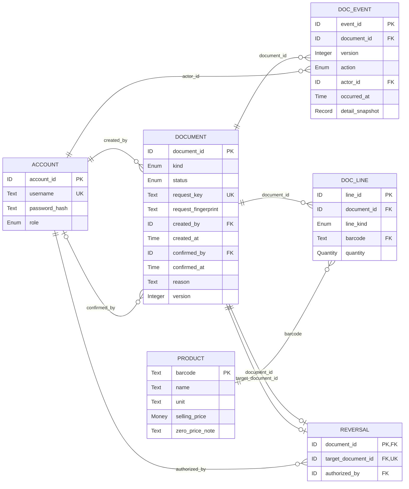
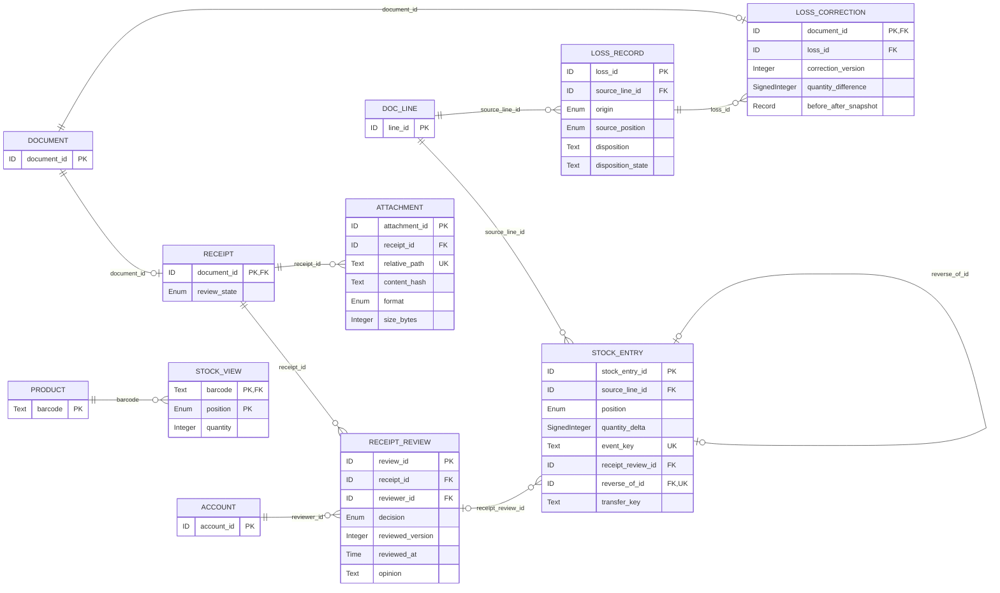
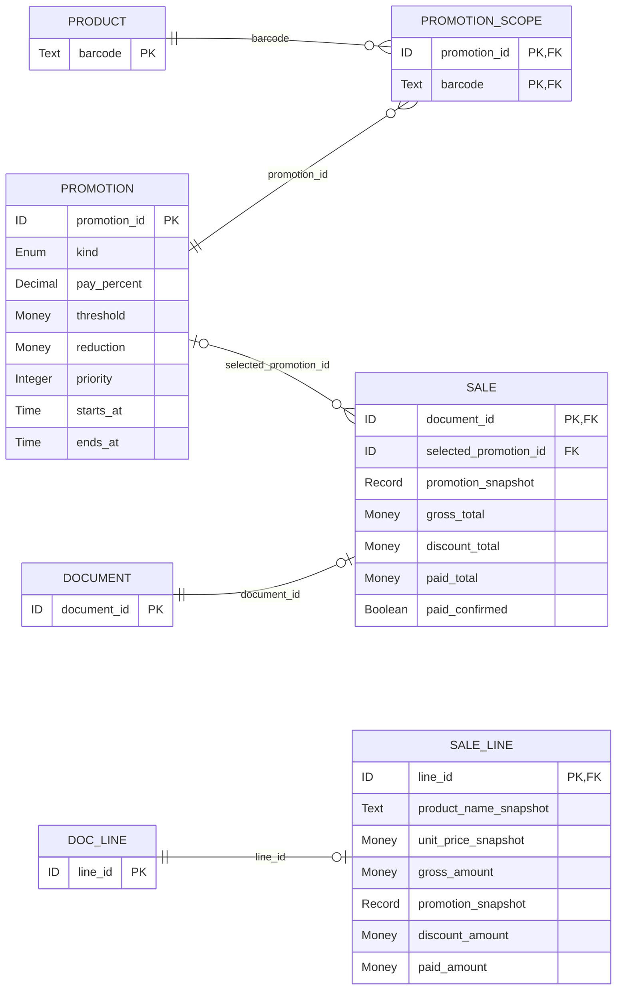
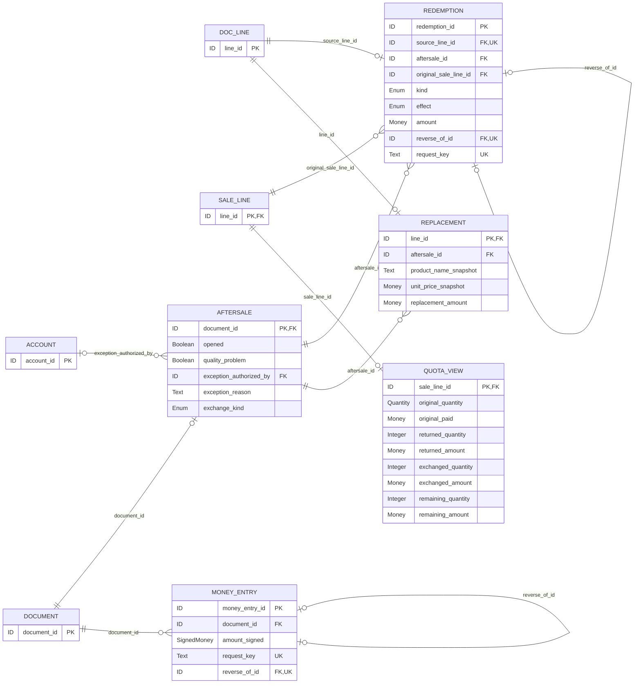

# 超市管理系统逻辑 ERD（中文）

## 1 文档状态、资料与权限边界

| 项目 | 内容 |
|---|---|
| 版本/日期 | 0.1，2026-10-20，Asia/Shanghai；本轮路径治理与提交状态修订 |
| 本文件 | [ERD当前副本](./Project_ERD.md)；仓库相对路径`docs/Project_ERD.md` |
| 状态 | 待人工审阅的逻辑设计草稿；四份核心资料可读，P1关系结构可供评审；不是数据库实现或已验收模型 |
| 课程根目录 | 负责人本机课程工作目录，不属于Git仓库；路径不随仓库分发 |
| 仓库根目录 | clone顶层；本机位于课程根目录的Project1，仓库内不再套一层Project1；本轮修订后提交并推送 |
| 功能基线 | [当前副本Spec](./Project_Spec.md)及[PRD](./Project_PRD.md)，均v0.5；共同维护主线为仓库docs/ |
| 当前产物 | 本中文工作主文档及四张同一模型的Mermaid分视图；核心审计依赖尚待审阅，具体分工暂缓；提交前转英文最终报告；暂无英文版、SQL、业务/测试代码 |
| 现有文件/备份 | 历史ERD创建时目标不存在；本轮保留既有ERD。历史文档备份位于课程相对路径（仓库外） `backups/Project_ERD.md_20261020_012233.md`，后续自审前亦留有带时间戳版本（最近 `backups/Project_ERD.md_20261020_012516.md`）；不在docs放备份 |

### 1.1 来源和定位

| 来源 | 本轮实际读取与定位 | 对本设计的限制 |
|---|---|---|
| C：`Projects1and2.pdf` | 15页全文提取；阅读器页码与各页印刷1–15一致。p3 §1.1/1.2，p4–6 §1.3/1.4及评分，p7–10 P2，p11–13通用/提交，p14–15附录 | p4–5要求Java CUI、OOP/SOLID、集合与File I/O、标准Maven/Gradle；未要求P1关系数据库或ERD交付；p3要求用例/类图与至少两次真实设计迭代，ERD不能替代这些图 |
| T：`Assignment1_Report_Template_CJLU2026.docx` | 读取OOXML正文/全部13表及页脚、脚注/尾注（如存在）；按章节/字段引用，不宣称打印分页已渲染验证 | §2.2表ID/Requirement/Description-acceptance/Priority；§3.2范围约束，§3.3 Figure2初版类图，§3.4评审表，§3.5 Figure3最终类图，§3.6演化表；§2.6/3.7反思必须本人写并签署；附录A/B日志/贡献 |
| S：`docs/Project_Spec.md` | 完整读取548行；重点§4 FR-01–15、§5权限、§7.1/7.3/7.4、§8 BR-01–29、§9/9.1 ERD-C01–10、§10/11/13/14/15/16 | 已确认范围/金额算法是需求依据；FR-14、BR-23撤销记录不是有效功能 |
| P：`docs/Project_PRD.md` | 完整读取365行；重点§3、PRD-03–09/12/13/15、§5.1/5.2、§6/7、§8/12 | §5.2引用S §9.1，售后公式/快照与S一致；只做追踪，不另建业务问题状态表 |
| U：本轮用户消息 | §III–VIII及两人昵称 | 只做中文逻辑模型；P1无商品日期/批次；P2预留措辞与S/P有差异，见§8 R1，不改S/P |

四份资料读取成功。PDF文本提取器提示若干对象偏移修复，但15页均提取出连续内容，本次关键条款可读取；未把提取器警告当作资料缺失，也不宣称检查了PDF视觉排版。无外部行业流程引用。

路径治理前的实际差异：两套Spec/PRD相同，ERD仅四处图源链接不同。本轮以仓库工作区为主保留现有相对链接，课程归档副本按其目录分别修正；同步/漂移检查见README，不再让仓库文档指向归档基线。

### 1.2 P1范围及设计表达

P1库存只按商品＋互斥位置“在售/在仓”计量，无生产日期、保质期、到期日、批次、临期提醒或过期拦截实体/外键。经办时间、促销起止和售后30天期限仍是必要业务数据。无供应商主数据管理、采购订单事前审批、顾客/会员、支付网关或第三不可售库存桶。

实体名、字段名、公共头/行、审计事件及正向/反向建模是**本ERD设计提案**，不是新增课程指定结构或已批准Java类/表名；由中文稿审阅确认。允许在JSON记录/集合中组合存储，不要求每实体对应独立文件或关系表。公共实体只为把源单、明细、流水、核销连接起来，避免无外键约束的任意sourceType+sourceId。

### 路径口径与副本身份

<!-- PATH-COPY-BEGIN -->
副本身份：仓库协作主副本；课程docs/为归档／交付副本。统一路径定义、计划/已创建区别和同步规则见[README路径治理说明](../README.md#路径基准与维护规则)。Markdown链接相对本文件所在目录解析；代码样式的`docs/evidence/...`、`docs/design/...`、`docs/decisions...`均明确为**仓库相对路径**，即使在课程归档副本中也不转义成归档目录。`Project1`是本机仓库目录名，不是“只存英文文件”的分类；仓库根目录下无额外Project1子目录。
<!-- PATH-COPY-END -->

文档备份为课程相对路径`backups/`，不属于仓库；旧版备份编号仅为负责人本机历史定位，不要求clone可访问。运行时快照备份以`DATA_ROOT`为基准，与文档备份分开。当前`docs/evidence/`、`docs/design/`、`docs/decisions/`及`docs/decisions.md`尚未创建，均为计划路径，不能作为已完成证据。

## 2 类型、主外键与状态约定

ID为不可变Text；具体UUID/前缀生成方式留后续技术设计，不影响唯一性。稳定销售行ID必须定义确定升序比较，在成交后不可重排；不得在JSON重载时按数组新序号重新生成。

Money为RMB十进制两位，HALF_UP；中间值四位和逐行落分沿用S §7.3，不用二进制浮点；SignedMoney为带方向款项。Quantity为业务整数1–9999；Integer为整数；库存累积余额不受“单次9999”硬套上限。Text为文本，Enum为闭合集合，Boolean为布尔，Time为可恢复且可解释至Asia/Shanghai的业务时间，Record为结构化不可变快照（逻辑类型，不是数据库JSON列要求）。

必填按可成立的完整记录定义；“确认时”字段允许草稿为空，但生效前必须齐全。“条件”见该行约束。PK/UK/FK是逻辑完整性；复合PK组成字段不能各自误设单列唯一。图中`||`=恰好1，`o`加竖线=0或1，`o{`=0..N；同图只画主要依赖，所有外键均在分视图及§4关系登记。条件必填画为可选，在状态规则中收紧。

公共DOCUMENT.status设计词汇：DRAFT、PENDING_REVIEW、NEEDS_CORRECTION、APPROVED、CONFIRMED、VOIDED；收货沿审核路径，其他单据不强加审核；生效销售/售后等为CONFIRMED。原业务VOIDED同时必须有反向事实，不能只变状态。收货RECEIPT.review_state与公共头状态为同一事实投影，不许两个独立状态自由组合。内部枚举是设计表达，不扩大用户审批流程。

## 3 实体关系图

以下四张是**同一个逻辑模型的分视图**，跨视图同名实体是同一实体；外部实体为减少拥挤只列主键，完整字段在数据字典。关系标签就是子方FK字段名，名称可直接追到§4。所有基数表达“存在记录”的结构可选性；已确认单据额外要求至少一条合法明细。共享主键扩展使用0..1，不代表一个销售单可以没有销售语义。

### 公共单据与审计

图源：[01_common.mmd](./erd/01_common.mmd)。中文设计图源，非英文版报告。

### 到货审核、附件与库存

图源：[02_receipt_stock.mmd](./erd/02_receipt_stock.mmd)。中文设计图源，非英文版报告。

### 销售与促销快照

图源：[03_sale_promotion.mmd](./erd/03_sale_promotion.mmd)。中文设计图源，非英文版报告。

### 售后双额度与反向款项

图源：[04_aftersale.mmd](./erd/04_aftersale.mmd)。中文设计图源，非英文版报告。

## 4 关系登记与条件基数

关系编号R-xx为本ERD内部设计索引，**不是新增需求编号**。每一FK恰好一条关系；必填条件按§5生效校验。图的关系标签与本表“子FK”一致。

| 关系 | 父实体/键 | 子实体.FK | 子记录指向父方 | 父记录可有子方 |
|---|---|---|---|---|
| R-01 | ACCOUNT.account_id | DOCUMENT.created_by | 1（必须存在） | 0..N |
| R-02 | ACCOUNT.account_id | DOCUMENT.confirmed_by | 0..1（条件时必填） | 0..N |
| R-03 | DOCUMENT.document_id | DOC_EVENT.document_id | 1（必须存在） | 0..N |
| R-04 | ACCOUNT.account_id | DOC_EVENT.actor_id | 1（必须存在） | 0..N |
| R-05 | DOCUMENT.document_id | DOC_LINE.document_id | 1（必须存在） | 0..N |
| R-06 | PRODUCT.barcode | DOC_LINE.barcode | 1（必须存在） | 0..N |
| R-07 | DOCUMENT.document_id | RECEIPT.document_id | 1（必须存在） | 0..1 |
| R-08 | RECEIPT.document_id | RECEIPT_REVIEW.receipt_id | 1（必须存在） | 0..N |
| R-09 | ACCOUNT.account_id | RECEIPT_REVIEW.reviewer_id | 1（必须存在） | 0..N |
| R-10 | RECEIPT.document_id | ATTACHMENT.receipt_id | 1（必须存在） | 0..N |
| R-11 | PROMOTION.promotion_id | PROMOTION_SCOPE.promotion_id | 1（必须存在） | 0..N |
| R-12 | PRODUCT.barcode | PROMOTION_SCOPE.barcode | 1（必须存在） | 0..N |
| R-13 | DOCUMENT.document_id | SALE.document_id | 1（必须存在） | 0..1 |
| R-14 | PROMOTION.promotion_id | SALE.selected_promotion_id | 0..1（条件时必填） | 0..N |
| R-15 | DOC_LINE.line_id | SALE_LINE.line_id | 1（必须存在） | 0..1 |
| R-16 | DOCUMENT.document_id | AFTERSALE.document_id | 1（必须存在） | 0..1 |
| R-17 | ACCOUNT.account_id | AFTERSALE.exception_authorized_by | 0..1（条件时必填） | 0..N |
| R-18 | DOC_LINE.line_id | REDEMPTION.source_line_id | 1（必须存在） | 0..1 |
| R-19 | AFTERSALE.document_id | REDEMPTION.aftersale_id | 1（必须存在） | 0..N |
| R-20 | SALE_LINE.line_id | REDEMPTION.original_sale_line_id | 1（必须存在） | 0..N |
| R-21 | REDEMPTION.redemption_id | REDEMPTION.reverse_of_id | 0..1（条件时必填） | 0..1 |
| R-22 | DOC_LINE.line_id | REPLACEMENT.line_id | 1（必须存在） | 0..1 |
| R-23 | AFTERSALE.document_id | REPLACEMENT.aftersale_id | 1（必须存在） | 0..N |
| R-24 | DOCUMENT.document_id | MONEY_ENTRY.document_id | 1（必须存在） | 0..N |
| R-25 | MONEY_ENTRY.money_entry_id | MONEY_ENTRY.reverse_of_id | 0..1（条件时必填） | 0..1 |
| R-26 | DOC_LINE.line_id | STOCK_ENTRY.source_line_id | 1（必须存在） | 0..N |
| R-27 | RECEIPT_REVIEW.review_id | STOCK_ENTRY.receipt_review_id | 0..1（条件时必填） | 0..N |
| R-28 | STOCK_ENTRY.stock_entry_id | STOCK_ENTRY.reverse_of_id | 0..1（条件时必填） | 0..1 |
| R-29 | DOC_LINE.line_id | LOSS_RECORD.source_line_id | 1（必须存在） | 0..N |
| R-30 | DOCUMENT.document_id | REVERSAL.document_id | 1（必须存在） | 0..1 |
| R-31 | DOCUMENT.document_id | REVERSAL.target_document_id | 1（必须存在） | 0..1 |
| R-32 | ACCOUNT.account_id | REVERSAL.authorized_by | 1（必须存在） | 0..N |
| R-33 | DOCUMENT.document_id | LOSS_CORRECTION.document_id | 1（必须存在） | 0..1 |
| R-34 | LOSS_RECORD.loss_id | LOSS_CORRECTION.loss_id | 1（必须存在） | 0..N |
| R-35 | PRODUCT.barcode | STOCK_VIEW.barcode | 1（必须存在） | 0..N |
| R-36 | SALE_LINE.line_id | QUOTA_VIEW.sale_line_id | 1（必须存在） | 0..1 |

补充结构约束：

- DOCUMENT可有0..N行以容纳草稿；提交收货及确认销售/退换/补货/报损须至少一行，冲销须覆盖原单全部生效影响。DOC_LINE只属于一个DOCUMENT。
- RECEIPT、SALE、AFTERSALE、REVERSAL、LOSS_CORRECTION是公共单据的条件扩展；按kind匹配且互斥。DOC_LINE中的SALE_LINE/REPLACEMENT扩展同理。补货/期初不另设空壳实体，使用公共单据/行及对应流水。
- SALE_LINE所属DOC_LINE.document_id必须指向有SALE扩展的单据，不能只因line_id存在就认为是销售行。REPLACEMENT的aftersale_id必须等于其来源行document_id，且为换货。
- REDEMPTION的原销售行关联是直接可验证引用，不使用商品条码代替原销售行。正向核销source_line必须是其aftersale_id所属售后行；释放核销source_line属于REVERSAL，aftersale_id保留原售后，不错误要求反向行还属于原单。
- 未经Spec批准，不规定“一个售后单只能引用一个销售单”、也不臆造一件旧品对应几个新品的换货配对算法；原销售可从每条核销行追踪。若界面需要更严格分组，应另提设计评审，不改变双额度模型。
- REPLACEMENT与同一售后的REDEMPTION通过AFTERSALE关联；不凭空添加1:1替换配对约束。核销类别应与售后退/换业务类型匹配。
- STOCK_ENTRY商品由DOC_LINE.barcode确定；不另存可漂移的商品FK。库存余额按该条码和position汇总，单条流水绝不能同时属于两个位置。
- 复合PK：PROMOTION_SCOPE(promotion_id,barcode)、STOCK_VIEW(barcode,position)；复合UK：DOC_EVENT(document_id,version)、LOSS_CORRECTION(loss_id,correction_version)。单列UK标在图和字段表。STOCK_ENTRY审核入库还须保证同收货行只生效入账一次，不能只靠不同review_id防重。
- ACCOUNT的多种关系分别表示建单、确认、审核、授权；人员可相同，自审不被外键或唯一性禁止。普通退换不要求exception_authorized_by；仅超期质量例外需店长。

## 5 数据字典

字段表是完整字典；图只省略跨视图外部实体的非键字段。派生视图不是独立业务事实。每实体说明中的FR/BR/ERD-C均已在当前S/P核对；ACCOUNT等英文名不是Spec中的既定Java类名。

### ACCOUNT — 经办账号

依据：FR-01/09；BR-04/16/21；R-AUTH。

| 字段 | 逻辑类型 | 必填 | 键/引用 | 含义 | 约束/一致性 |
|---|---|---|---|---|---|
| account_id | ID | 是 | PK | 具体经办账号标识 | 不可用角色字符串代替个人 |
| username | Text | 是 | UK | 本地登录名 | 本地唯一 |
| password_hash | Text | 是 | - | 密码哈希编码 | 非明文；算法/盐等封装在编码内，具体算法为后续安全设计 |
| role | Enum | 是 | - | 角色 | 管理员/店长/店员，权限按Spec §5 |

### PRODUCT — 商品

依据：FR-02；BR-05/06；R-INPUT。

| 字段 | 逻辑类型 | 必填 | 键/引用 | 含义 | 约束/一致性 |
|---|---|---|---|---|---|
| barcode | Text | 是 | PK | 商品条码 | 8–14位数字，保留前导0；唯一 |
| name | Text | 是 | - | 品牌加商品名 | 成交时另存快照 |
| unit | Text | 是 | - | 固定包装计量单位 | 无称重或小数数量 |
| selling_price | Money | 是 | - | 当前售价 | 0–999999.99；零价须明确标记 |
| zero_price_note | Text | 条件 | - | 赠品/零价说明 | 售价0时必填 |

### DOCUMENT — 业务单据公共头

依据：FR-03/05/07/08/09/12/13；BR-07/16/21/29。

| 字段 | 逻辑类型 | 必填 | 键/引用 | 含义 | 约束/一致性 |
|---|---|---|---|---|---|
| document_id | ID | 是 | PK | 单据标识 | 稳定且全局唯一 |
| kind | Enum | 是 | - | 业务类型 | 收货/销售/退货/换货/补货/期初/报损/冲销/报损修正 |
| status | Enum | 是 | - | 单据状态 | 见§5状态条件，不作为库存位置 |
| request_key | Text | 是 | UK | 整次业务幂等键 | 唯一；相同键不同请求内容拒绝 |
| request_fingerprint | Text | 确认时 | - | 请求内容摘要 | 绑定幂等键，防同键异内容 |
| created_by | ID | 是 | FK:ACCOUNT.account_id | 建单人 | 存在且符合操作权限 |
| created_at | Time | 是 | - | 创建时间 | Asia/Shanghai可解释时间 |
| confirmed_by | ID | 确认时 | FK:ACCOUNT.account_id | 确认经办人 | 确认后必填，售后不需逐笔店长批准 |
| confirmed_at | Time | 确认时 | - | 确认时间 | 与状态、事件一致 |
| reason | Text | 条件 | - | 业务原因 | 售后/报损/补正/作废/修正须记录 |
| version | Integer | 是 | - | 单据修订版本 | 递增；确认后只新增审计/反向记录 |

### DOC_EVENT — 单据审计事件

依据：FR-09/13；BR-16/21/25/29；ERD-C07/08。

| 字段 | 逻辑类型 | 必填 | 键/引用 | 含义 | 约束/一致性 |
|---|---|---|---|---|---|
| event_id | ID | 是 | PK | 事件标识 | 不可变 |
| document_id | ID | 是 | FK:DOCUMENT.document_id | 所属单据 | 与版本组成UK |
| version | Integer | 是 | - | 事件版本 | UK(document_id,version) |
| action | Enum | 是 | - | 动作 | 创建/提交/补正/审核/确认/冲销/处置/修正 |
| actor_id | ID | 是 | FK:ACCOUNT.account_id | 经办人 | 与动作权限相符 |
| occurred_at | Time | 是 | - | 发生时间 | 真实业务时间 |
| detail_snapshot | Record | 是 | - | 变化前后及原因快照 | 记录必要状态/字段差异；不可覆盖旧事件 |

### DOC_LINE — 公共商品明细

依据：FR-03/05/07/08/12/13；BR-06/07；ERD-C09。

| 字段 | 逻辑类型 | 必填 | 键/引用 | 含义 | 约束/一致性 |
|---|---|---|---|---|---|
| line_id | ID | 是 | PK | 稳定业务行ID | 销售行也使用此ID；确认后不重排 |
| document_id | ID | 是 | FK:DOCUMENT.document_id | 所属单据 | 一个明细只属于一个单据 |
| line_kind | Enum | 是 | - | 行用途 | 收货/销售/售后核销/替换品/补货/期初/报损/反向/修正 |
| barcode | Text | 是 | FK:PRODUCT.barcode | 商品 | 与所有扩展记录/流水商品一致 |
| quantity | Quantity | 是 | - | 本行业务正数量 | 1–9999；流水符号另记，不以负数量表示顾客购买 |

### RECEIPT — 实际到货单扩展

依据：FR-03；BR-03/19；Q04。

| 字段 | 逻辑类型 | 必填 | 键/引用 | 含义 | 约束/一致性 |
|---|---|---|---|---|---|
| document_id | ID | 是 | PK,FK:DOCUMENT.document_id | 收货单头 | kind必须为收货；明细为DOC_LINE收货行 |
| review_state | Enum | 是 | - | 收货审核状态 | 待审核/审核通过/退回补充修正；与公共状态一致 |

### RECEIPT_REVIEW — 收货审核记录

依据：FR-03/15；BR-03/07/19。

| 字段 | 逻辑类型 | 必填 | 键/引用 | 含义 | 约束/一致性 |
|---|---|---|---|---|---|
| review_id | ID | 是 | PK | 审核事件 | 每次判断单独留存 |
| receipt_id | ID | 是 | FK:RECEIPT.document_id | 所审收货单 | 同单可补正/重审，最多一次生效通过入账 |
| reviewer_id | ID | 是 | FK:ACCOUNT.account_id | 审核人 | 店长或技术可审管理员，可为原建单人 |
| decision | Enum | 是 | - | 审核结果 | 通过/退回补充修正 |
| reviewed_version | Integer | 是 | - | 所审单据版本 | 不得为过时版本入账 |
| reviewed_at | Time | 是 | - | 审核时间 | 通过后生成库存流水须同次生效 |
| opinion | Text | 是 | - | 审核依据/意见 | 不以缺图片自动阻止审核 |

### ATTACHMENT — 采购发票图片

依据：FR-15；BR-19/27；R-INPUT。

| 字段 | 逻辑类型 | 必填 | 键/引用 | 含义 | 约束/一致性 |
|---|---|---|---|---|---|
| attachment_id | ID | 是 | PK | 附件标识 | 唯一 |
| receipt_id | ID | 是 | FK:RECEIPT.document_id | 关联到货单 | 每单0–3张，无图也能审核 |
| relative_path | Text | 是 | UK | 本地副本路径 | 相对DATA_ROOT保存`attachments/<文件名>`，统一`/`；不含源绝对路径；安全规则见Spec §10.1，根定位/失败流程待审 |
| content_hash | Text | 是 | - | 副本内容哈希 | 恢复时校验，不作为跨单去重强约束 |
| format | Enum | 是 | - | 图片格式 | JPG/PNG |
| size_bytes | Integer | 是 | - | 大小 | 单张≤5MB；字节口径见待审阅R4 |

### PROMOTION — 促销配置

依据：FR-06；BR-09/11/28；R-PROMO/R-INPUT。

| 字段 | 逻辑类型 | 必填 | 键/引用 | 含义 | 约束/一致性 |
|---|---|---|---|---|---|
| promotion_id | ID | 是 | PK | 活动ID | 同价最终按稳定ID比较 |
| kind | Enum | 是 | - | 优惠类型 | 折扣/满减 |
| pay_percent | Decimal | 折扣时 | - | 支付比例百分数 | 1–99%；90表示九折 |
| threshold | Money | 满减时 | - | 门槛 | >0 |
| reduction | Money | 满减时 | - | 满减金额 | >0且≤门槛 |
| priority | Integer | 否 | - | 显式优先级 | 有胜无，高胜低；同级或都无按小ID |
| starts_at | Time | 是 | - | 活动开始 | 开始日00:00:00，含边界 |
| ends_at | Time | 是 | - | 活动结束 | 结束日23:59:59，含边界，不是商品到期日 |

### PROMOTION_SCOPE — 活动适用商品关联

依据：FR-06；BR-28；ERD-C02。

| 字段 | 逻辑类型 | 必填 | 键/引用 | 含义 | 约束/一致性 |
|---|---|---|---|---|---|
| promotion_id | ID | 是 | PK,FK:PROMOTION.promotion_id | 活动 | 与barcode组成复合PK |
| barcode | Text | 是 | PK,FK:PRODUCT.barcode | 适用商品 | 仅表达明确适用集合，不扩展类别/会员优惠 |

### SALE — 成交销售单扩展

依据：FR-05/06；BR-07/10/11；ERD-C01/02。

| 字段 | 逻辑类型 | 必填 | 键/引用 | 含义 | 约束/一致性 |
|---|---|---|---|---|---|
| document_id | ID | 是 | PK,FK:DOCUMENT.document_id | 销售单 | kind为销售 |
| selected_promotion_id | ID | 否 | FK:PROMOTION.promotion_id | 选中单一活动 | 可无活动，不允许每单同时选多个 |
| promotion_snapshot | Record | 是 | - | 活动参数/适用集/优先级快照 | 无活动也明确记录NONE；后续修改不影响原单 |
| gross_total | Money | 确认时 | - | 折扣前合计 | 等于行gross_amount合计 |
| discount_total | Money | 确认时 | - | 订单优惠 | 等于行discount_amount合计 |
| paid_total | Money | 确认时 | - | 订单实收应付 | 等于行paid_amount合计及确认款项 |
| paid_confirmed | Boolean | 是 | - | 付款完成确认 | 确认销售必须为真，不代表接入支付网关 |

### SALE_LINE — 不可变成交行快照

依据：FR-05/06/07；BR-10/13/28；ERD-C01/02。

| 字段 | 逻辑类型 | 必填 | 键/引用 | 含义 | 约束/一致性 |
|---|---|---|---|---|---|
| line_id | ID | 是 | PK,FK:DOC_LINE.line_id | 销售行ID | 其DOC_LINE所属单据必须存在SALE扩展 |
| product_name_snapshot | Text | 是 | - | 成交商品名称 | 不得用当前商品名覆盖 |
| unit_price_snapshot | Money | 是 | - | 成交单价 | 数量来自DOC_LINE.quantity，确认后不可改 |
| gross_amount | Money | 是 | - | 折扣前行额 | 单价×数量按已确认规则落分 |
| promotion_snapshot | Record | 是 | - | 本行活动及适用性 | 标明NONE/不适用/活动ID及参数、适用权重依据 |
| discount_amount | Money | 是 | - | 本行优惠分摊 | ≥0且≤gross_amount；最后适用行承接尾差 |
| paid_amount | Money | 是 | - | 本行原实付P | gross_amount−discount_amount；售后唯一金额上限 |

### AFTERSALE — 退换货业务扩展

依据：FR-07/08；BR-21/22/26；ERD-C03/06。

| 字段 | 逻辑类型 | 必填 | 键/引用 | 含义 | 约束/一致性 |
|---|---|---|---|---|---|
| document_id | ID | 是 | PK,FK:DOCUMENT.document_id | 售后单据 | kind为退货或换货 |
| opened | Boolean | 是 | - | 是否开封 | 与quality_problem一起判断资格 |
| quality_problem | Boolean | 是 | - | 是否商品质量原因 | 不免库存校验 |
| exception_authorized_by | ID | 条件 | FK:ACCOUNT.account_id | 超期质量例外店长 | 普通合规售后不需要 |
| exception_reason | Text | 条件 | - | 例外原因 | 超期质量例外时必填 |
| exchange_kind | Enum | 换货时 | - | 换货计价情形 | 一般换货/同款同数量质量换零补差，按原行事实校验 |

### REDEMPTION — 售后原行额度核销及反向记录

依据：FR-07/08/09；BR-12/13/15/29；ERD-C03–08。

| 字段 | 逻辑类型 | 必填 | 键/引用 | 含义 | 约束/一致性 |
|---|---|---|---|---|---|
| redemption_id | ID | 是 | PK | 核销事件标识 | 不可变 |
| source_line_id | ID | 是 | UK,FK:DOC_LINE.line_id | 来源售后或冲销业务行 | UK确保同业务行不重复生效 |
| aftersale_id | ID | 是 | FK:AFTERSALE.document_id | 原售后单 | 反向事件也保留原售后关联 |
| original_sale_line_id | ID | 是 | FK:SALE_LINE.line_id | 原成交行 | 每条核销只关联一个原行 |
| kind | Enum | 是 | - | 核销类别 | 退货退款/换货原商品抵扣 |
| effect | Enum | 是 | - | 占用或释放 | CONSUME/RELEASE；释放只来自授权整单冲销 |
| amount | Money | 是 | - | 原商品额度金额 | ≥0；非新品价格或顾客补差 |
| reverse_of_id | ID | 释放时 | UK,FK:REDEMPTION.redemption_id | 反向事件关联原核销 | 0..1；每原核销最多释放一次；禁止自引用和释放套释放 |
| request_key | Text | 是 | UK | 核销请求键 | 同键异内容拒绝；与整单原子键绑定 |

### REPLACEMENT — 换货发给顾客的商品

依据：FR-08；BR-15/20；ERD-C06。

| 字段 | 逻辑类型 | 必填 | 键/引用 | 含义 | 约束/一致性 |
|---|---|---|---|---|---|
| line_id | ID | 是 | PK,FK:DOC_LINE.line_id | 替换商品业务行 | line_kind必须替换品 |
| aftersale_id | ID | 是 | FK:AFTERSALE.document_id | 换货单 | 同DOC_LINE所属单据；必须为换货 |
| product_name_snapshot | Text | 是 | - | 替换品名称 | 可追溯 |
| unit_price_snapshot | Money | 是 | - | 新品当前售价快照 | 不用来覆盖原行P |
| replacement_amount | Money | 是 | - | 本替换行金额 | 按新品快照及数量计算；仅从在售扣存 |

### MONEY_ENTRY — 收款/退款及补退差记录

依据：FR-05/07/08/09；BR-07/15/16；ERD-C06–08。

| 字段 | 逻辑类型 | 必填 | 键/引用 | 含义 | 约束/一致性 |
|---|---|---|---|---|---|
| money_entry_id | ID | 是 | PK | 款项记录标识 | 不可变 |
| document_id | ID | 是 | FK:DOCUMENT.document_id | 来源单据 | 销售/退货/换货/冲销 |
| amount_signed | SignedMoney | 是 | - | 超市收款正、退款负 | 0可用于零补差确认；不与原商品核销amount混淆 |
| request_key | Text | 是 | UK | 款项幂等键 | 同次整单不能重复收退 |
| reverse_of_id | ID | 反向时 | UK,FK:MONEY_ENTRY.money_entry_id | 原款项记录 | 一对零或一反向；符号相反且绝对金额相同 |

### STOCK_ENTRY — 库存流水

依据：FR-03/04/05/08/09/12/13；BR-03/07/08/20/25；ERD-C06–09。

| 字段 | 逻辑类型 | 必填 | 键/引用 | 含义 | 约束/一致性 |
|---|---|---|---|---|---|
| stock_entry_id | ID | 是 | PK | 库存事件标识 | 不可变 |
| source_line_id | ID | 是 | FK:DOC_LINE.line_id | 业务来源行 | 从此追至单据及经办人/时间 |
| position | Enum | 是 | - | 唯一库存位置 | 在售或在仓，只能取其一 |
| quantity_delta | SignedInteger | 是 | - | 有符号变动量 | 非0；商品由来源行确定 |
| event_key | Text | 是 | UK | 入账事件键 | 同次审核/销售/补货/换货/报损不会重记 |
| receipt_review_id | ID | 审核入库时 | FK:RECEIPT_REVIEW.review_id | 通过审核的来源 | 收货入仓时必填，其他变动为空 |
| reverse_of_id | ID | 反向时 | UK,FK:STOCK_ENTRY.stock_entry_id | 被冲销流水 | 相同商品位置、相反数量，最多一次 |
| transfer_key | Text | 补货时 | - | 同次转移关联 | 对应一在仓负/一在售正，合计0 |

### LOSS_RECORD — 损耗或待处置记录

依据：FR-07/08/13；BR-14/21/25；ERD-C06/08。

| 字段 | 逻辑类型 | 必填 | 键/引用 | 含义 | 约束/一致性 |
|---|---|---|---|---|---|
| loss_id | ID | 是 | PK | 损耗记录 | 非库存桶 |
| source_line_id | ID | 是 | FK:DOC_LINE.line_id | 报损或顾客交回来源行 | 商品/数量由来源行确定 |
| origin | Enum | 是 | - | 损耗来源 | 店内现存货/顾客交回 |
| source_position | Enum | 店内现存货时 | - | 原库存位置 | 在售/在仓；顾客交回必须为空 |
| disposition | Text | 是 | - | 实际去向/暂存处理 | 不得增第三库存余额 |
| disposition_state | Text | 是 | - | 实际处理进度 | 名称为设计表达，不新增审批流 |

### REVERSAL — 授权整单冲销

依据：FR-09；BR-16/29；R-VOID；ERD-C08。

| 字段 | 逻辑类型 | 必填 | 键/引用 | 含义 | 约束/一致性 |
|---|---|---|---|---|---|
| document_id | ID | 是 | PK,FK:DOCUMENT.document_id | 冲销单 | kind为冲销；每次只做整单 |
| target_document_id | ID | 是 | UK,FK:DOCUMENT.document_id | 被作废原单 | 不物删；有未解除下游依赖时禁止 |
| authorized_by | ID | 是 | FK:ACCOUNT.account_id | 授权人 | 店长/管理员；原因取本单DOCUMENT.reason |

### LOSS_CORRECTION — 报损修正记录

依据：FR-13；BR-25；R-VOID；ERD-C08。

| 字段 | 逻辑类型 | 必填 | 键/引用 | 含义 | 约束/一致性 |
|---|---|---|---|---|---|
| document_id | ID | 是 | PK,FK:DOCUMENT.document_id | 修正单 | kind为报损修正，原因/经办/时间在公共头 |
| loss_id | ID | 是 | FK:LOSS_RECORD.loss_id | 被修正原损耗 | 原记录保留 |
| correction_version | Integer | 是 | - | 修正版本 | UK(loss_id,correction_version) |
| quantity_difference | SignedInteger | 是 | - | 相对前版数量差额 | 可正/负/0；不负库存 |
| before_after_snapshot | Record | 是 | - | 修正前后及处置差异 | 不能仅覆盖原记录；库存影响须对应流水 |

### STOCK_VIEW — 库存余额视图（派生）

依据：FR-04；BR-08/20；ERD-C09/10。

| 字段 | 逻辑类型 | 必填 | 键/引用 | 含义 | 约束/一致性 |
|---|---|---|---|---|---|
| barcode | Text | 是 | PK,FK:PRODUCT.barcode | 商品 | 与position构成复合PK |
| position | Enum | 是 | PK | 位置 | 在售/在仓，余额行不表达商品状态 |
| quantity | Integer | 是 | - | 对应位置余额 | Σ该商品该位置有效有符号流水；≥0；缺行视为0，不再加待审数量 |

### QUOTA_VIEW — 原销售行售后额度视图（派生）

依据：FR-07/08；BR-12/13/15/29；ERD-C04/05。

| 字段 | 逻辑类型 | 必填 | 键/引用 | 含义 | 约束/一致性 |
|---|---|---|---|---|---|
| sale_line_id | ID | 是 | PK,FK:SALE_LINE.line_id | 原销售行 | 最多一份缓存，允许即时计算 |
| original_quantity | Quantity | 是 | - | 原购Q | 来自DOC_LINE.quantity |
| original_paid | Money | 是 | - | 原实付P | 来自SALE_LINE.paid_amount |
| returned_quantity | Integer | 是 | - | 已退Qr | 含合法释放后的净额 |
| returned_amount | Money | 是 | - | 已退款额度Mr | 不是额外独立预算 |
| exchanged_quantity | Integer | 是 | - | 已换Qx | 含合法释放后的净额 |
| exchanged_amount | Money | 是 | - | 已用于换货原商品抵扣Mx | 零补差换货也占用 |
| remaining_quantity | Integer | 是 | - | Q−Qr−Qx | ≥0 |
| remaining_amount | Money | 是 | - | P−Mr−Mx | ≥0；结清数量使用全部此余额 |

## 6 跨实体完整性及P1文件持久化

PK/FK和图本身不能执行跨行汇总、审批、原子性或权限。以下是模型的验证契约，后续由获准的业务/文件持久化实现保证；本轮没有实现或测试这些契约。

### 6.1 到货、审核和附件

RECEIPT待审/补正的DOC_LINE数量只用于待审展示，不能加入STOCK_VIEW，也不是第三库存桶。审核事件保留被审版本；店长可对本人建单审核，管理员技术可审但不担日常职责。只有第一次有效通过可产生每收货行在仓+q，STOCK_ENTRY.receipt_review_id指向该通过事件，source_line_id及event_key共同保证重复提交/重复通过不增第二次入库。退回补充/修正不产生流水，修改后必须重新审当前版本。

已通过后不能通过编辑旧明细改变已入账事实；应按S R-VOID及既定修正/冲销约束处理，不能把“补正”当作供应商退货。附件0–3张，JPG/PNG及大小按R-INPUT；无图照常由店长判断通过或补正，不建自动发票识别/联网审批流程。

### 6.2 数量库存与追溯

余额(product,position)=所有已生效原流水及反向流水的quantity_delta合计；原流水不得因原单VOIDED而被额外从汇总排除，否则再加反向流水会双重冲销。待生效单不写已生效流水；失败整单没有部分事件。缓存只可由事实重建，不得另改余额绕过流水。

| 单据/动作 | 必须产生的数量影响 | 来源/约束 |
|---|---|---|
| 期初 | 指定商品/位置+q，有期初来源单/行 | BR-08/20；不直接编辑无来源余额 |
| 收货审核通过 | 在仓+q | 待审/补正均0；不得通过两次入两次 |
| 补货 | 同transfer_key下在仓−q、在售+q，同商品同单行，合计0 | 不能两位置重复计，来源在仓不足拒绝 |
| 销售确认 | 在售−q，整单所有行一并核库存、确认已收款 | 不能用在仓抵扣，不挂单/支付网关 |
| 换货替换品 | 每REPLACEMENT来源行在售−q | 交回旧品0；不能因换货补差0免扣替换品 |
| 顾客退货/换回品 | 两位置均0；LOSS_RECORD.origin为顾客交回 | source_position为空，不再扣现有库存 |
| 店内报损 | 来源位置−q，另记实际处置 | 后续处置更新/追加审计，不再次扣存 |
| 整单冲销 | 每原STOCK_ENTRY有同商品/位置、相反数量的反向行，reverse_of_id不可重复 | 原因/授权由REVERSAL和公共头追踪，不能只改状态 |
| 报损修正 | LOSS_CORRECTION记录版本/差额/前后；如影响数量则对应差额流水 | 管理员修正，不覆盖原记录，不负库存 |

任一出库后的相应位置余额必须≥0；不允许负库存纠错，异常按来源单/行展示该商品入库记录核对。下游销售/补货/售后/损耗依赖未解除时，禁止作废上游；本模型提供来源链，**不会声称两位置汇总即可证明每次耗用的精确来源**。如何关联“同商品汇总库存下的耗用依赖”是R3设计待审点，不引入批次追踪替代。

### 6.3 成交快照和促销分摊

SALE只选0或1个活动；活动无叠加。同一订单按各候选落分后应付最低者选用，同价显式有胜无、高胜低，同级或都无按小活动ID。promotion_snapshot保存当时适用集合/参数/优先级，SALE_LINE保存本行适用性、折扣前行额、分摊优惠和实付。PROMOTION_SCOPE当前配置后来变化不改变原销售行。

沿用S §7.3、BR-28已确认公式：适用行权重为该行折扣前金额÷适用行原额合计；逐行优惠两位HALF_UP；稳定行ID升序最后适用行承接剩余优惠，非适用行折扣0；行gross−discount=paid，行优惠/实付均非负，合计与SALE一致。零额适用合计不触发正门槛满减，不除零。**ERD没有补出新的折扣金额舍入修正规则**；极小金额下的矛盾见R2，不能从图中擅自选处理结果。

AC-54静态核对示例：适用原额60和40、满100减15、非适用20；适用行优惠9和6、实付51和34，非适用实付20，订单105；退第一行全部数量按其保存51退款而非60。AC-41三行原额各10、总优惠10：优惠3.33/3.33/3.34，实付6.67/6.67/6.66，合计20。这里只复核已批准预期，没有执行程序测试。

### 6.4 退换共用双额度

每原SALE_LINE，Q取其DOC_LINE.quantity，P取其paid_amount。正向REDEMPTION.effect=CONSUME计入已退/已换，合法RELEASE只反向减回所指原事件的数量和金额。RELEASE不得作为新退款或新库存入库事件独立重复执行。

Qremain=Q−Qr−Qx；Premain=P−Mr−Mx；必须同时≥0。未结清时占用min(HALF_UP(P×q/Q,2),Premain)，本次结清剩余数量时用全部Premain。换货先消耗双额度，随后退货只使用剩余；**不追溯重排已生效历史，不把“换货优先”解释成随意挤掉旧退款**。金额按原销售行，不跨行另分退款预算。原单零价时P=0，合法退换仍核销数量，金额可0，不因金额为0跳过幂等/数量校验。

原商品抵扣为REDEMPTION.amount；新品金额为REPLACEMENT.replacement_amount；顾客补退差为MONEY_ENTRY.amount_signed；三者不可混为同一字段。一般换货新品金额−本次原商品抵扣为补退差；同款同数量质量换货差额0仍消耗原数量/金额。退货现金方向负，原行核销amount仍为非负额度。

| 已确认场景 | 已换Qx/Mx | 已退Qr/Mr | 剩余数量/金额 |
|---|---|---|---|
| 原Q=3、P=10.00，未售后 | 0/0 | 0/0 | 3/10.00 |
| 先换1件（AC-56） | 1/3.33 | 0/0 | 2/6.67 |
| 再退剩余2件（AC-56） | 1/3.33 | 2/6.67 | 0/0；总核销3件/10.00 |
| 同款质量零差换1件，原Q=1、P=8（AC-58） | 1/8.00 | 0/0 | 0/0，后续不得再退8 |

每次确认在同一提交边界检查两个余额并写入原核销、款项、损耗去向及替换品流水。QUOTA_VIEW是可重算投影；不能让售后模块各自维护一套独立“可退金额”。

### 6.5 幂等、反向审计和文件恢复

DOCUMENT.request_key保护整单，核销/款项/库存的唯一事件键保护具体生效记录；相同键相同内容返回既有结果，相同键不同内容拒绝。指纹只是设计手段，不是新增用户认证功能。正向核销source_line_id唯一；审核入库还要按原收货行/首次有效通过限制，不能简单用“新审核ID”作为再入库理由。

草稿按S BR-16可删除；不得删除已确认单据或被生效事实引用的行，草稿清理也不得产生悬空引用。

冲销先确认授权及下游无依赖，REVERSAL.target_document_id唯一；生成反向DOC_LINE、STOCK_ENTRY、MONEY_ENTRY和REDEMPTION RELEASE，各自reference指向原记录。不得物删已确认单，也不能仅置VOIDED或只释放数量不释放金额。反向事件须与目标原记录数量/金额一一相反，唯一reverse_of_id防止二次释放；禁止自引用或形成循环引用；正反向角色须一致。对反向单进一步操作的业务流程未在基线明确，本ERD不自行批准或禁止，只建模已确认的原单及反向审计。

S FR-10/TC-05/08要求的P1实现仍是UTF-8 JSON单快照/schemaVersion/Jackson、临时写＋原子替换＋上一版备份；本图不增加数据库事务。全单先在工作副本校验，只有新快照完整生效才更新成功反馈/可见内存状态；写失败保留旧状态。库存流水、核销、款项和单据必须属于同一已提交快照，不能分别保存形成半笔售后。相对附件路径/哈希应在快照关联可验证；失败导入残留副本不能形成已批准业务记录。

启动/恢复校验PK/UK、FK存在与类型、单据状态、快照等式、已确认销售收款、位置非负、双额度上限、反向记录金额数量/方向、审核入账幂等、附件路径/哈希；损坏阻断写并提示恢复，不自动空库覆盖。文件根schemaVersion是存储元数据，不在图中强行变成业务实体；具体JSON布局和版本兼容属后续技术设计；DATA_ROOT定位与附件失败语义只引用Spec §10.1 PATH-D01/02，不由本ERD擅定，也不构成ERD关系评审阻塞。

### 6.6 运行路径治理引用

附件`relative_path`只相对于DATA_ROOT保存`attachments/<文件名>`并使用`/`，不是相对仓库、工作目录、JAR或本Markdown。路径穿越/绝对引用/根外真实路径必须拒绝；中文和空格原样处理，禁止默默覆盖已验证副本。DATA_ROOT默认位置及附件失败处理仍未批准，统一引用[Spec §10.1](./Project_Spec.md#101-运行路径契约与待确认设计) PATH-D01/02；不能从图中PK/UK推断生成文件名、重名或缺失附件的业务批准策略。文档备份在课程backups，运行快照上版备份是DATA_ROOT下待定运行布局，两者分开。

## 7 需求追踪

以下按当前Spec真实编号映射。图实体名、字段和R-xx是本ERD设计名，不冒充FR/BR。FR-14及BR-23只追踪撤销边界，不能计为已实现功能；FR-11是交互要求，无需为每个菜单虚构实体。

| 关键实体/关系/约束 | FR/BR来源 | ERD-C（如适用） | PRD/场景 | 课程/模板来源 |
|---|---|---|---|---|
| ACCOUNT及所有经办/审核/授权FK；DOCUMENT/DOC_EVENT | FR-01/09；BR-04/16/21；R-AUTH | C07/08/09 | PRD-01/09；AC-09/28/51 | C p3用户交互，T §2.2/3.2；具体三角色权限来自S，不冒称课程指定 |
| PRODUCT及DOC_LINE商品FK、固定整数 | FR-02；BR-05/06；R-INPUT | C09/10 | PRD-02；AC-21/29/53 | C p4–5集合/File I/O及健壮；T §2.2 |
| RECEIPT/RECEIPT_REVIEW/DOC_LINE；审核到STOCK_ENTRY | FR-03/04；BR-03/07/19 | C07/09 | PRD-03/04；AC-04/24/26 | T §3.2/3.5；具体收货方案来自S §7.1 |
| ATTACHMENT到RECEIPT及相对路径哈希 | FR-15/10；BR-19/27/17 | C09 | PRD-15/10；AC-11/36/40/53 | C p4–5真实File I/O；T §1/3.5 |
| SALE/SALE_LINE、DOC_LINE及PROMOTION/SCOPE | FR-05/06；BR-09/10/11/28 | C01/02/09 | PRD-05/06；AC-31/41/44/54/55 | C p3–5设计与实现；算法仅S §7.3 |
| AFTERSALE/REDEMPTION原SALE_LINE FK | FR-07/08；BR-12/13/21/22/26/29 | C03/04/05/07 | PRD-07/08；AC-33/46/47/56–58 | T §3.2/3.5；业务公式仅S §7.4 |
| QUOTA_VIEW按REDEMPTION净额聚合 | FR-07/08；BR-12/13/15/29 | C04/05/09 | PRD §5.2；AC-46/56/58 | C p4–5数据真实参与功能；无需单独数据库表 |
| REPLACEMENT、MONEY_ENTRY及在售出库 | FR-05/07/08；BR-07/14/15/20 | C06/07/08 | PRD-08；AC-14/18/34/56/58/59 | T §2.2/3.2；具体补差来自S |
| STOCK_ENTRY源行/审核/反向/转移关系，STOCK_VIEW | FR-04/05/08/12；BR-03/06/07/08/20 | C06/08/09/10 | PRD-04/05/08/12；AC-12/13/22/30/35/59 | C p4–5集合/File I/O；T §3.2/3.5 |
| LOSS_RECORD/LOSS_CORRECTION及处置审计 | FR-13/07/08；BR-14/25；R-VOID | C06/08/09 | PRD-13；AC-15/18/37/52 | T §3.4/3.6记录设计决定，不是已执行证据 |
| REVERSAL和三种流水self-FK；唯一幂等键 | FR-09/10；BR-07/16/17/29 | C07/08/09 | PRD-09/10；AC-35/36/52/57/59 | C p4健壮与File I/O；T §1/3.5 |
| 没有日期/批次实体和FK；保留业务时间 | FR-14撤销；BR-20/23 | C10 | PRD-14撤销/§5.2；AC-42/43；P2差异见R1 | C未强制该超市业务，T §3.2写范围 |
| CUI/退出/非法输入（非实体） | FR-11；BR-18 | 无专属C条目 | PRD-11；AC-05 | C p5 rubric交互健壮；ERD不声称能实现菜单 |

上表C01–C10均为Spec实际`ERD-C01`至`ERD-C10`的缩写，不是课程代号C。对照如下：C01=成交行归属/快照；C02=优惠/实付等式；C03=原行到核销一对多；C04=双额度汇总；C05=部分/结清规则；C06=原抵扣/新品/补差分离；C07=幂等与整单一次生效；C08=反向审计；C09=类型/唯一/引用/恢复；C10=范围无日期批次。十项均存在，可追踪；没有缺失编号或“无法追踪”的FR/BR/ERD-C条目。课程没有逐项规定这些超市实体或金额公式，应使用S而非伪造PDF出处。

## 8 差异、待审阅及稳定性

下列R1–R5是本ERD审阅索引，不修改或另建Spec问题状态表；已批准的分摊权重/实付依据/退换双额度不重新提问。全部仅记录在本文。

| 项目 | 可核实的差异/证据 | 影响和处理边界 |
|---|---|---|
| R1：P2范围措辞 | 本轮§III说P1无日期/批次，作为P2预留；S §7.2/§14、ERD-C10及P §5.2/§6明确P1/P2均删除，源为此前U6 | P1无冲突。按本轮要求将“P2可讨论预留”记录于此，但不建实体/字段/实现接口、不声称已与基线P2一致；需人工审阅是否另行变更S/P的P2范围，未同步前沿用原删除记录。非P1核心关系阻塞 |
| R2：极小金额促销舍入 | S §7.3规定逐行优惠HALF_UP、末行承尾差，同时ERD-C02要求优惠/实付非负；AC-44两行0.05的90%候选应付0.09。折扣是先按行还是整候选落分再分配，极小值例未给一致展开。满减反例：四条不同适用商品行原额各0.01、总额0.04、满减0.02，权重各1/4；若前3行各0.005按HALF_UP得0.01，末行尾差=0.02−0.03=−0.01，与ERD-C02优惠非负冲突，不能默认均匀/回溯调整 | 核心字段和等式明确，但极端金额算法须独立审阅。本模型只保存已确认结果/分摊依据，不补造修正公式或更改AC-44。可选的行舍入/候选落分协调须由金额规则负责人提交评审，不作为新正式验收 |
| R3：汇总库存的耗用依赖 | S R-VOID/AC-52要求原单有后续耗用则先冲销下游；S ERD-C10只按商品/位置、无批次，未规定来源收货到各次耗用的匹配算法 | 当前source_line链和同转移key可表达业务来源，但不能推导库存消耗到底属于哪个历史收货。保留粗粒度同商品关联核查；更精确依赖匹配/保守阻断策略不得由ERD冒充业务定案。影响作废执行策略，不改变商品/位置/流水核心FK |
| R4：附件5MB口径 | S R-INPUT/P PRD-15规定≤5MB，未指定十进制5,000,000或5×1024²字节 | size_bytes保留整数；大小阈值在实现前按一次技术边界审阅明确，不把其中一个值写成已批准业务。与核心关系无关 |
| R5：基线同步/旧阶段文字 | P §12仍写“本阶段不绘ERD、不细分任务”，S §9.1标题也标“只列清单”；这些是上一轮交付边界。本轮已明确授权ERD/两人初步分工，且要求四源只读 | 本轮ERD及末尾计划以新授权执行；不修改S/P，不把旧阶段边界当永久禁止。历史建模时有双副本；本轮路径治理已明确仓库docs为主、课程docs为归档，差异需比较而不能假定内容相同 |

课程硬要求冲突：未发现C或T要求把商品日期/批次放入P1，未发现课程指定另一套满减/退货算法。C p3–5的用例/类图、两次设计迭代、OOP/CUI/File I/O要求继续有效；本ERD不能取代最终类图，也不能以本轮分视图冒称两次真实迭代。C p7–10的P2 GUI/Derby/Git/JUnit要求仅记边界，不实现。

模型稳定性结论：P1主要实体与已确认公式可建模，但R3尚未明确从汇总库存追踪后续耗用的关系表达，可能需要新增或调整单据依赖关系；R2同时影响金额完整性是否始终成立。不能据此宣称核心模型已稳定。依本轮§VI，暂不写具体两人模块分工，先保留共同审阅及恢复条件；模型的现有部分作为待审阅草稿交付。

## 9 报告材料和交付检查

| 模板/课程定位 | 本阶段记录/后续何时补充 | 本文与产物 |
|---|---|---|
| T §2.1/2.2、§3.2 | 现在保存范围、需求映射、R1–R5以及设计取舍；不代写§2.6反思 | 本文§1/7/8；ERD建模阶段Spec/PRD只读；本轮仅同步路径规则 |
| T §3.3 Figure2、§3.4评审表、§3.5 Figure3、§3.6变化表 | 后续真实类图V1、AI审查/学生决定、V2及时留档；ERD可作数据设计支持材料，不替代类图 | 本轮为ERD v0.1，没有捏造第二版设计或实现 |
| T §3.7、§2.6及声明 | 学生在真实审阅时记个人判断，阶段后本人独立写反思与签署 | 本文只提供事实与来源，不生成可提交反思 |
| T 附录A.1/A.2/A.3 | 现在登记实际AI建模协作、人的修改/拒绝；后续记录真实开发调试，不能把计划说成已完工 | 记录本轮只读四源、模型提案、未实现限制 |
| T 附录B；C p2/p12团队贡献 | 具体两人工作包暂缓；实际设计/实现/测试/报告贡献后续逐步保留，再按事实确认贡献比例 | 不填写真实姓名学号/能力/完成百分比，不预设50/50 |
| T §1；C p4/p12–13 | 获准开发后收集真实构建/凭证/运行/保存证据；提交前核单ZIP及≤5分钟视频 | 本轮无运行结果、SQL、数据库/业务代码、远程仓库 |

检查结果：四源可读；实体/字段由同一字典生成分视图；每个FK在关系表可查；所有FR/BR及ERD-C01–10引用经当前S校验；P1无日期/批次字段；原销售快照与核销双上限有明确关联；草稿/已确认差异、审核幂等、反向事件及文件提交完整性均记录。图源语法和主外键登记做静态核对，不声称业务测试已通过；本轮用Mermaid CLI渲染四张分视图并逐张查看PNG预览，均成功、关键字段/关系标签可读；预览仅作本机QA，交付的可编辑图源仍为四个.mmd及本文内嵌图，不是英文版。英文最终报告在提交前据中文工作稿制作；中文工作稿不作为并行提交版本。

ERD建模时四份只读输入的历史SHA-256（非当前路径治理后文件哈希；当前副本漂移按README规则另查）：

| 文件 | SHA-256 |
|---|---|
| Projects1and2.pdf | `51ff1a39277c55a8db1be064f3ee5f23b7cd289337892f96482889bf87e95460` |
| Assignment1_Report_Template_CJLU2026.docx | `10a37ba103db986a3c8286d57d512875841c90f2051d44b15335e23e3353dc0b` |
| docs\Project_Spec.md | `73daca73dd23e2ae04ab1db3fdec4968a68dae4ab1dacf1a64c1023e72a13edb` |
| docs\Project_PRD.md | `ffd6a97f1424c8d87e19903a81209ba46ad229d9fee9c5e7760392e50c26a2d2` |

## 10 两人分工准备：具体计划暂缓

已登记参与者：**组员（本人，A1moss）**、**组员（CGwal）**。不虚构真实姓名、能力或贡献比例。

本轮§VI规定核心实体/关系受未解决冲突影响而不稳定时，不写具体分工。R3可能影响库存依赖关系，R2是现有金额完整性规则的具体反例，因此暂不把模块负责人、开发工作包或交接接口定案；这不是资料缺失，也不是重问已确认的退款口径、分摊权重和双额度原则。

恢复分工前，两人共同评审：

1. 处理R2的极小金额分摊反例，形成可保持优惠/实付非负且合计守恒的明确规则；实际需要变更S/P时，由获授权的后续文档阶段同步，本轮不修改。
2. 明确R3汇总库存下的耗用依赖表达及作废边界，确定是否新增依赖关系；不得通过添加日期/批次实体绕过P1范围。
3. 核对现有公共单据/行ID、请求幂等键、金额/时间/状态和快照提交边界；核销/款项/库存必须单次合并提交，不能由两个模块各写半笔交易。
4. 审阅通过中文ERD后，再按商品/收货/库存与销售/促销/售后等边界形成候选工作包，明确共享接口和整单提交合并点，并让两人均显著参与设计和实现（C p2）；当前不指定负责人或分工比例。

共同评审应沿用AC-26审核幂等、AC-27整单销售、AC-54满减实付、AC-56先换后退双额度、AC-59失败/冲销等既有场景，不伪造测试通过。英文最终报告在提交前制作，中文工作稿不作为并行提交版本；具体编码须后续授权。本轮路径治理与报告安排修订已提交并推送至GitHub `origin/main`。
